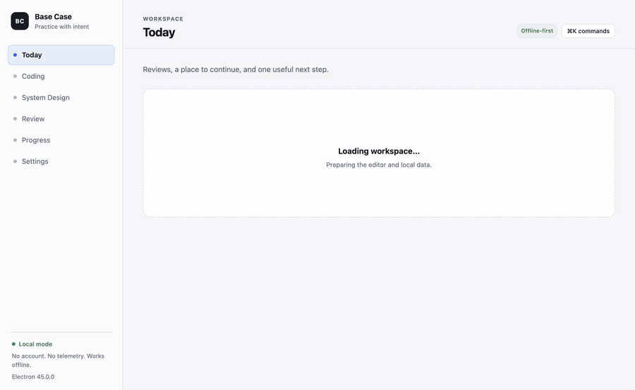

# Base Case

> Working name. Base Case is a local-first practice app for coding interviews
> and system design. It is not affiliated with LeetCode or any other judge.

**Status:** Phase 9 MVP expansion. The app has 81 original coding problems
(including a 75-problem Grind 75 collection), 8 system design scenarios, 39
offline lessons covering DSA and system-design fundamentals, a real
Python/TypeScript judge, FSRS review, an optional guarded AI tutor, local
persistence, a diagnostics self-test, dual-arch macOS packaging, and a security
review. Manual accessibility verification, demo media, the release candidate,
and the private beta are pending. The B4 content review is closed for the alpha
via owner waiver; B5 name risk is accepted and B6 (GitHub project setup) is
deferred by owner decision. An independent human second-person review remains a
v1.0 requirement. The real-model AI bug-zoo eval is complete (59/60 cases reviewed at
100% diagnosis accuracy and 4.9/5 helpfulness), and the Windows `0.1.0-alpha`
installer passed its diagnostics check with bundled runtimes; clean-OS isolation
was waived by the owner for the alpha. See `docs/project/open-blockers.md`.



A 10-second tour is in `docs/demo.md` ([MP4](docs/assets/demo/base-case-demo.mp4)).

## Why

Online judges hide tests and say "wrong answer." Offline judges often need
Docker. AI tools tend to hand over solutions. Progress tracking is usually just
"solved / not solved." System design practice is separate from coding practice.

Base Case closes the loop: **attempt → failure → explanation → fix → review**.

- **Offline-first:** the judge, content, progress, canvas, and review queue work
  with no network.
- **Local-first:** no account, no telemetry; data stays on the machine.
- **AI is optional:** bring your own OpenAI-compatible provider. The app works
  without it.
- **Learning over grinding:** hints, explanations, mistake tags, and spaced
  repetition matter more than problem count.
- **Honest limits:** hidden tests are not a security boundary, and sandboxing is
  best-effort on Windows.

## Requirements

- Node.js 24+
- pnpm 12+ (enable with `corepack enable`; the repo pins the exact version)
- Go 1.27+ (judge sidecar)
- Python 3.10+ and Node on `PATH` for the Phase 1 judge
- macOS 13+ or Windows 10 21H2+ / 11

Linux is explicitly out of scope for the initial releases.

## Quickstart

```sh
corepack enable
corepack pnpm install
corepack pnpm judge:build
corepack pnpm dev
```

Then:

- Open **Learn**, read **Hash Maps and Sets**, and open its linked practice.
- Open **Coding**, select **Pair Sum**, and run the sample tests.
- Replace the starter code with a one-pass hash-map solution and submit.
- Open **System Design**, draw, wait for “Saved locally,” and reload.
- Configure the mock or an OpenAI-compatible provider in **Settings**.

Validation commands:

```sh
corepack pnpm format:check
corepack pnpm lint
corepack pnpm typecheck
corepack pnpm test
corepack pnpm content:validate
corepack pnpm content:test
corepack pnpm smoke:e2e
corepack pnpm smoke:playwright
```

Packaging:

```sh
corepack pnpm package:mac   # ad-hoc signed arm64 + x64 DMG and ZIP
corepack pnpm package:win   # NSIS + ZIP
```

Packaging fetches pinned Python and Node runtimes into `build/runtime` and
bundles them in the installer. Development runs can use the same packs with
`corepack pnpm runtimes:fetch`; otherwise the judge falls back to system
runtimes. See ADR-0010.

## What works now

- Secure Electron + React + TypeScript shell with a narrow typed preload API.
- 81 original coding problems across hash maps, two pointers, stacks, binary
  search, sliding windows, linked lists, trees/BSTs, graphs, topological sort,
  union-find, heaps, tries, deques, backtracking, intervals, bit manipulation,
  greedy, matrix traversal, and dynamic programming. Each has 3–5 sample tests,
  at least 15 hidden tests, four hints, an explanation, common mistakes,
  follow-ups, and Python/TypeScript reference solutions.
- A **Learn** library with 39 offline lessons: 22 DSA/foundation lessons and 17
  system-design lessons. The DSA track covers Big O, arrays and strings, hash
  maps, two pointers, sliding windows, prefix sums, sorting, binary search,
  stacks, queues/deques, linked lists, recursion/backtracking, trees, BSTs,
  heaps, tries, graphs/traversal, topological sort and union-find, greedy and
  intervals, bit manipulation, matrix traversal, and dynamic programming. The
  system-design track covers the core topic index of the public System Design
  Primer (CC BY 4.0), from performance and availability through DNS, reverse
  proxies, application architecture, storage selection, network protocols,
  security, estimation references, and reading real architectures. All
  explanations, diagrams, and examples are original to Base Case. Each lesson
  has plain-language explanations, ASCII diagrams, worked examples, a complexity
  cheatsheet, interview notes, common mistakes, self-check questions, and linked
  coding or design exercises. Completion is stored locally, and every lesson
  remains readable without AI.
- A **Grind 75** collection filter over a 75-problem core subset of the public
  Grind 75 study list. The list is maintained by Tech Interview Handbook; this
  app is not affiliated with or endorsed by it. Every statement, example, hint,
  and test is original to Base Case.
- Eight system design scenarios (URL Shortener, Rate Limiter, Chat System, News
  Feed, Seat Reservation, Search Autocomplete, File Sync, Payment Ledger) with
  prompts, requirements, scale targets, seven-dimension rubrics, reference
  designs, expected-topic checklists, and Markdown/PNG export.
- Real Go judge execution with function, in-place, linked-list, and tree
  signatures; structured statuses; time/memory/output limits; cancellation;
  compile-once TypeScript; and exact/unordered/float/set-of-sets checkers.
- Bundled pinned Python 3.12 and Node 24 runtimes, a macOS Seatbelt sandbox,
  Windows Job Object limits, and arm64/x64 macOS installers with matching
  runtimes and judge binaries.
- CodeMirror editors with autocomplete for common TypeScript/JavaScript and
  Python members, syntax-error markers, Tab indentation, autosave to SQLite,
  language switching, failing-line highlighting, and Copy/Reset controls.
- Structured failure panel, FSRS review queue, mistake tags, Today and Progress
  dashboards (including a 14-day activity chart), and JSON data export/import.
- Content pack import (ZIP or folder) with schema validation, preview, an
  Unverified badge, and removal that preserves attempts.
- Excalidraw canvas with local scene persistence and PNG export.
- SQLite (WAL) migrations, attempts, drafts, design scenes, notes, lesson
  progress, settings, AI feedback, and verified startup backups.
- Optional AI: mock and OpenAI-compatible providers, token-budgeted context,
  structured outputs, guardrails, per-feature toggles, design-note review,
  explain-back checks, lesson clarification, user-confirmed mistake-tag
  suggestions, and a local bug-zoo eval harness. AI is off by default.
- Diagnostics self-test for the database, storage, logs, content, search index,
  judge, runtimes, and AI configuration, with a copyable report that never leaves
  the machine unless you copy it.
- Installer checksums (`SHA256SUMS.txt`) and a tag-driven GitHub Release
  job, plus an alpha feedback issue form.

Still open: manual accessibility verification (B11), refreshed screenshots and
demo media for the Learn library, the release candidate, optional reference
Excalidraw scenes, local AI history, the Apple Foundation Models sidecar, the
private beta. B1 and B4 are closed by owner waiver, B2/B3 are done, B5 name risk
is accepted, and B6 GitHub project setup is intentionally deferred. The real-model AI eval (B3) is complete with 59/60 cases reviewed; see `docs/project/open-blockers.md`. Windows filesystem and network isolation remain
best-effort.

## Repository layout

```text
apps/desktop/          Electron main, preload, React renderer
services/judge/        Go judge sidecar, harnesses, checkers, protocol tests
packages/schema/       Content schemas, types, pack validation
packages/content-cli/  validate and test commands for content packs
content/packs/core/    Bundled core pack (81 coding + 8 designs + 39 lessons; 75-problem Grind 75 collection)
docs/evals/            Bug zoo, eval runner notes, and recorded results
content/templates/     Problem and design templates
scripts/               Judge build, runtime fetch, CDP smoke, packaged measurement
docs/                  ADRs, architecture, authoring, spikes, project docs
```

## Documentation

- `PLAN.md` — product definition, architecture, phases, risks, decisions.
- `PROGRESS.md` — living status log; read this first when returning.
- `docs/spikes/phase-1-report.md` — measurements, gaps, go/no-go.
- `docs/spikes/windows-verification.md` — Windows install and end-to-end checklist.
- `docs/quickstart.md` — install, first run, and the two-minute tutorial.
- `docs/install.md` — macOS/Windows install steps and first-launch approval.
- `docs/faq.md` — common questions.
- `docs/privacy.md` — local data and AI data flow.
- `docs/known-limitations.md` — alpha limits.
- `docs/troubleshooting.md` — logs and AI provider 401/403 debugging.
- `docs/screenshots.md` — generated screenshots of the main workflows.
- `docs/project/alpha-release.md` — release checklist, beta plan, triage, metrics.
- `docs/project/security-review.md` — Electron checklist, judge limits, dependency audit.
- `docs/project/accessibility.md` — automated gate and manual assistive-tech checklist.
- `docs/project/states-audit.md` — loading, empty, and error states per view.
- `docs/project/performance.md` — packaged performance numbers and budgets.
- `docs/architecture/overview.md`
- `docs/architecture/judge-protocol.md`
- `docs/architecture/threat-model.md`
- `docs/authoring/content-policy.md`
- `docs/authoring/problem-authoring.md`
- `docs/authoring/lesson-authoring.md`
- `docs/evals/README.md`
- `docs/project/open-blockers.md`
- `docs/project/definition-of-done.md`

## Security and privacy

- No telemetry, accounts, or cloud backend.
- API keys are stored with Electron `safeStorage` and never exposed to the
  renderer.
- The judge runs in a temp directory with limits, sanitized environment, and
  process-group cleanup.
- Read `SECURITY.md` before reporting a vulnerability.
- The app is a practice tool, not a formal assessment or a hostile-code sandbox.

## Contributing

See `CONTRIBUTING.md` and `docs/project/code-review-checklist.md`. Content
contributions must be original; do not copy statements, examples, constraints,
or tests. Sign off commits with `git commit -s`.

Good first issues: add an original easy problem, improve an empty state, add a
keyboard shortcut, write a troubleshooting doc, or add a judge conformance
fixture.

## License

- Code: MIT (`LICENSE`).
- Original content: CC BY-SA 4.0 (`CONTENT_LICENSE`).
- Third-party components: `NOTICE`.

"Base Case" is a provisional working name. Preliminary research found existing software/training uses; the owner accepted the name risk for the public repository and will rename if a concern is raised (B5).
