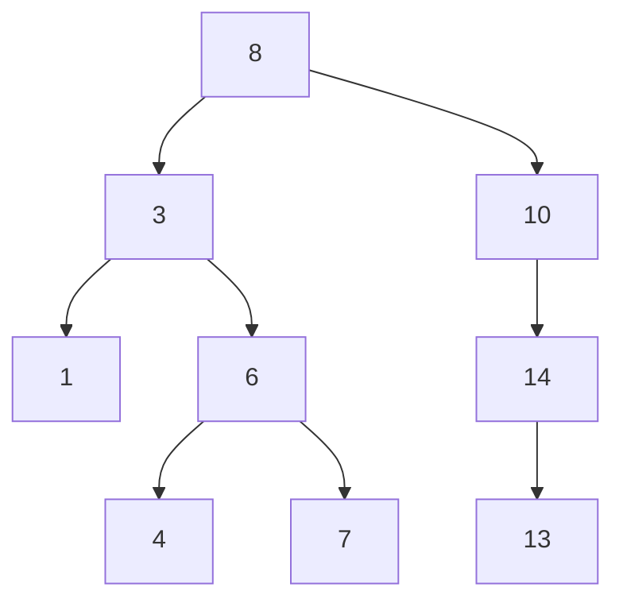
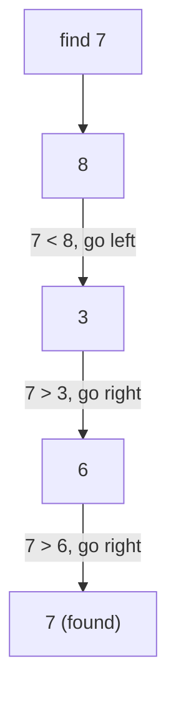
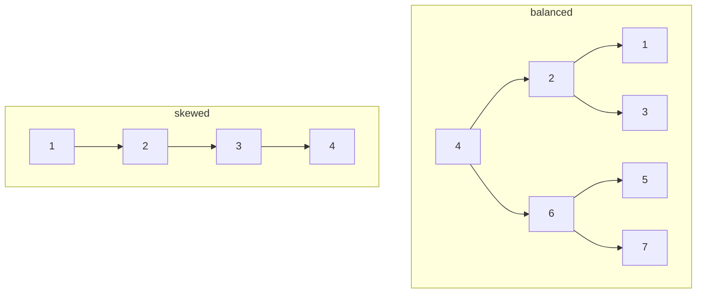
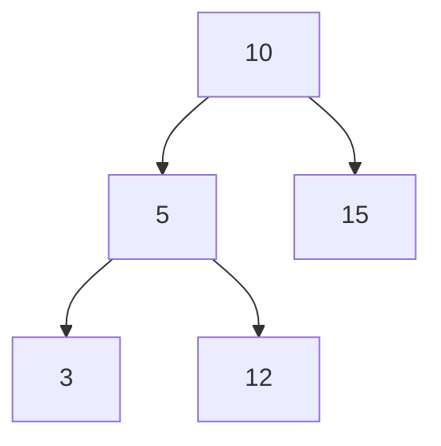

# Binary Search Trees

A binary search tree (BST) is a binary tree with one extra rule:

> For every node, all values in the left subtree are smaller, and all values in the right subtree are larger.



This rule turns a search into a series of choices.

## Searching



At each node you discard one entire subtree. If the tree is balanced, the height is about `log n`, so the search is `O(log n)`. If the tree is skewed, the height is `n`, and the search is `O(n)`.



A BST is not automatically balanced. The insertion order decides the shape.

## Inorder is sorted

An inorder traversal visits left subtree, node, right subtree.

```text
1, 3, 4, 6, 7, 8, 10, 13, 14
```

For a valid BST, this sequence is sorted. That gives two useful facts:

- To collect values in order, use inorder.
- To check order, you can compare each visited value with the previous one.

## Validating a BST

The tempting check is "left child is smaller and right child is larger." That is not enough.



`12` is smaller than `15` and larger than `5`, but it is in the left subtree of `10`. It violates the rule.

Carry a range down the recursion:

```text
validate(node, low, high):
    if node is null: return true
    if node.value <= low or node.value >= high: return false
    return validate(node.left, low, node.value)
        and validate(node.right, node.value, high)
```

Every node must fit inside the range allowed by all of its ancestors. This is `O(n)` time and `O(h)` space.

## Finding the kth smallest

Inorder traversal visits values in ascending order. Count as you go and stop at `k`.

```text
inorder: 1, 3, 4, 6, ...
k = 3 -> answer 4
```

If the tree supports subtree sizes, you can skip whole subtrees:

```text
if left_size + 1 == k: return node.value
if k <= left_size: go left
else: k -= left_size + 1; go right
```

That is `O(h)` rather than `O(n)`.

## Deletion

Three cases:

1. **Leaf**: remove it.
2. **One child**: replace the node with that child.
3. **Two children**: find the smallest value in the right subtree (the successor), copy it into the node, then delete the successor from the right subtree.

The successor is the next value in sorted order, so replacing with it preserves the BST rule.

## The practical warning

A BST is useful when you need ordered operations and the tree stays reasonably balanced. In production, self-balancing variants such as AVL or red-black trees maintain `O(log n)` height. In an interview, say "assuming the tree is balanced" when you quote `O(log n)`, or state the height-based bound `O(h)`.
