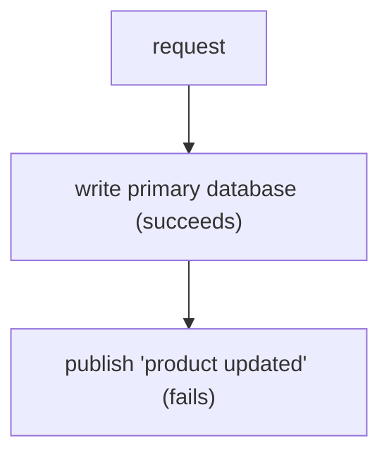
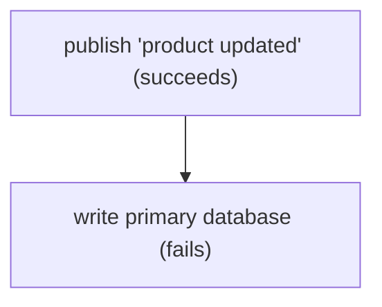
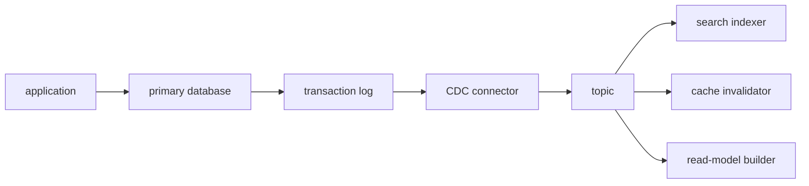
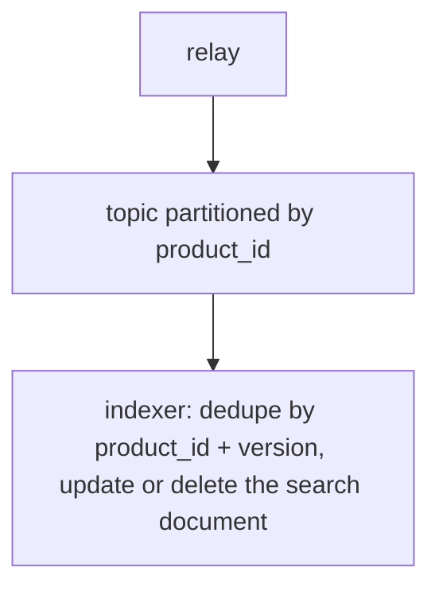
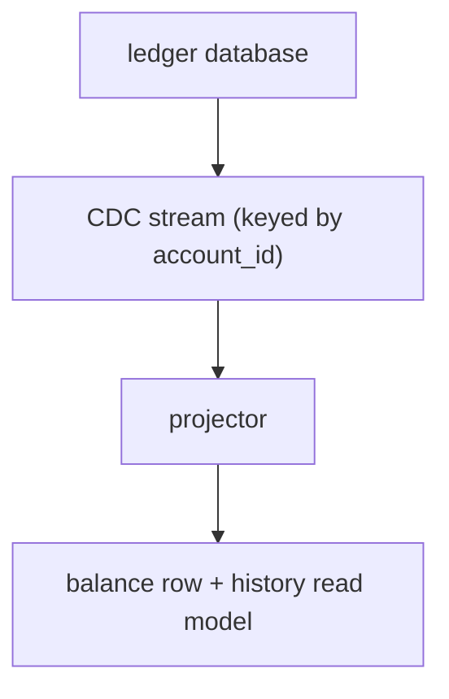

# Change Data Capture and Derived Stores

Most systems have one source of truth and several copies. A search index, cache, read model, and analytics table repeat data from the primary database. The hard part is keeping the copies correct when the source changes. A dual write looks easy and fails in production. Change data capture (CDC) is a way to derive the copies from committed changes instead.

## The dual-write problem

A service writes the database, then publishes an event.



The database is fresh and the search index is stale. Nothing retries the event because the request already returned success.

The reverse order is no better.



Now the search index contains a product that does not exist.

Two systems, one request, and no shared transaction. A retry helps only when the failure is visible to the writer. A crash between the two steps leaves no record of the missing update. The fix is to make one system responsible for the change stream and to derive the other copies from it.

## How CDC works

Most databases already write a log for replication and recovery: the write-ahead log in PostgreSQL, the binary log in MySQL, or the oplog in MongoDB. A CDC connector reads that log, turns row changes into events, and publishes them to a broker. Some databases expose logical replication, which presents row changes in a stable format instead of raw storage blocks.



The application writes once. The connector captures inserts, updates, and deletes after they commit. Tools such as Debezium and Kafka Connect follow this shape, but the product name is less important than the guarantees.

A new consumer usually needs a snapshot of existing rows, then a stream of changes from the matching log position. The snapshot and the stream must line up. If the snapshot is taken at an earlier position and the stream starts later, changes in between are lost. If the snapshot overlaps the stream, changes are applied twice. Consumers must tolerate the overlap.

## The transactional outbox

Some teams cannot read the database log, or they want business events instead of raw row changes. The transactional outbox pattern writes the event in the same transaction as the business change.

```text
BEGIN
  update product set title = ...
  insert into outbox(event_id, type, payload)
COMMIT

relay:
  read unsent outbox rows
  publish to broker
  mark rows as sent
```

The business row and the event commit together or not at all. The relay can still crash after publishing and before marking the row, so delivery is at-least-once. The consumer deduplicates by `event_id`.

An outbox table grows. Prune sent rows on a schedule, or let CDC read the outbox table and skip the polling relay. The pattern is simple to describe and needs monitoring for relay lag and unsent rows.

## Ordering, idempotency, and replay

Global order across a database is expensive and rarely required. Per-entity order is usually enough. Partition the topic by the entity key, such as `product_id` or `account_id`. Every change for one entity lands on the same partition and keeps its order.

Consumers should still be idempotent. Store processed event IDs with a time to live, or use a version column and apply a change only when the incoming version is newer.

Replay is a feature, not an accident. A consumer can reset an offset and rebuild a derived store from the log. For a large store, build a new index, backfill the snapshot, replay the tail, compare counts, then switch an alias. Keep enough log retention for the rebuild window.

## Schema evolution

Events outlive the code that produced them. Add fields with defaults. Consumers should ignore fields they do not know. Do not rename or reuse a field without a version plan. A breaking change needs a new event version or a new topic, plus a period where both are published and consumers are migrated.

Row-level CDC reflects the table schema. Renaming a column can break every consumer. Some teams publish a stable view or a dedicated event schema so internal table changes do not leak into the stream.

## Lag and failure handling

A CDC pipeline has more failure points than a single database. Monitor all of them:

- connector lag between the database log and the broker;
- consumer lag between the broker and the derived store;
- database log retention, because a stopped connector can fill the disk;
- broker retention, because a stopped consumer can lose its place;
- dead-letter queue depth;
- snapshot progress and time.

A poison message should go to a dead-letter queue after a bounded number of retries, not loop forever. A periodic reconciliation job compares source and derived counts or checksums. Reconciliation catches the gaps that monitoring misses.

Deletes need a plan too. A delete event or tombstone must reach every copy. Keep tombstones long enough for the slowest consumer, then expire them.

## Derived stores need a contract

A search index, a cache, and a read model are all copies, but each has a different contract.

- The search index needs query fields, analyzer settings, delete handling, and a rebuild path.
- The cache needs a key, an invalidation method, and a TTL as a backstop.
- The read model needs the query shape it serves, a checkpoint, and a way to rebuild from the source.

Each copy needs an owner, a freshness target, and a rebuild plan. The primary database remains the source of truth. A cache can be lost, an index can be rebuilt, and a projection can be deleted and replayed. If a copy holds data that cannot be reconstructed, it is no longer derived.

## Worked example: search index sync

A product service owns a relational table. Search needs a separate index with tokenized titles, filters, and ranking.

```text
BEGIN
  update product row
  insert outbox row (product_id, version, changed fields)
COMMIT
```



The indexer acknowledges only after the search write succeeds. A mapping change builds a new index and switches an alias. A nightly job compares product IDs and document counts, then reindexes the differences. The freshness target is part of the contract: 99% of changes visible within 2 seconds, with an alert at 30 seconds.

One product decision remains. A user who edits a product may expect to see the change immediately. The UI can show the saved value from the primary, or the service can read the owner's document from the primary until the index catches up. State the choice instead of assuming the index is always current.

## Worked example: ledger projection

A ledger stores immutable double-entry postings. A read model needs current balances and a recent history view.



The projector applies each posting once, updates the balance, and records a checkpoint. It can rebuild by loading a balance snapshot at a log position and replaying later postings. The ledger remains the source of truth. The projection can be deleted and rebuilt without touching the ledger.

Reconciliation compares the projection total with the ledger total per account. A mismatch is a real incident, not a cache miss.

## When CDC is overkill

CDC adds a broker, connectors, schemas, lag, and a new failure surface. Skip it when:

- one service owns the data and a read replica serves the queries;
- a cache with a short TTL can tolerate stale reads;
- a nightly batch job meets the freshness requirement;
- the write rate is low and the application can invalidate the cache directly;
- no one can operate the pipeline.

The outbox pattern alone can be enough when the only goal is reliable event publication. Start with the simplest mechanism that meets the freshness target.

## What to say in an interview

> "The search index is derived data, so I would not dual-write it from the request path. The product table and an outbox row commit in one transaction. A relay publishes events keyed by product ID, and the indexer deduplicates by product ID and version. Per-key order keeps updates from overtaking each other. Lag is monitored, poison messages go to a dead-letter queue, and a reconciliation job repairs drift. For a large mapping change, I build a new index and switch an alias. If freshness were measured in hours, a nightly batch would be enough and CDC would be unnecessary."
