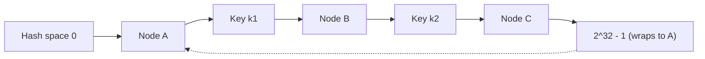
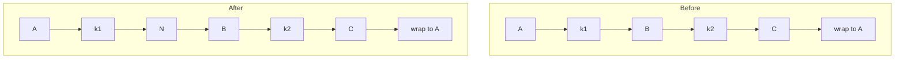
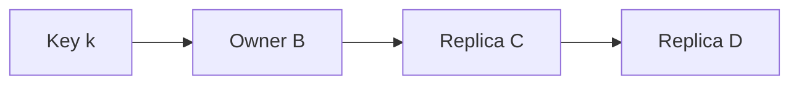

# Consistent Hashing

Consistent hashing assigns keys to nodes so that adding or removing a node moves only a small share of the keys. It matters when the assignment is expensive to change, such as a cache or a large data store.

## The modulo problem

With N nodes, the usual assignment is `hash(key) % N`.

```text
4 nodes:
key A hash=10 -> 10 % 4 = 2 -> node 2
key B hash=11 -> 11 % 4 = 3 -> node 3
key C hash=12 -> 12 % 4 = 0 -> node 0
```

Add a fifth node and the modulus changes. Most keys now map somewhere else.

```text
going from 4 nodes to 5:
  keys that stay on the same node: about 20%
  keys that move:                  about 80%

going from 100 nodes to 101:
  keys that move: almost all of them
```

The exact fraction depends on the old and new counts. In a cache, a remap means a burst of misses and a load spike on the database. In a data store, it means moving almost the entire data set.

## The hash ring

Consistent hashing maps both nodes and keys onto a circle. It helps to unroll the circle into a line.



Each node hashes to a position. Each key hashes to a position. To find the owner, walk clockwise from the key until you reach a node. `k1` belongs to B. `k2` belongs to C. A key past C wraps around and belongs to A.

The ring works because each node owns only the arc between its predecessor and itself. A key's owner depends on the nearest node clockwise, so a change in one arc does not disturb keys in other arcs.

## Adding and removing nodes

When a node joins, it takes only the keys between its predecessor and itself. Those keys used to belong to the next node clockwise.



Node N takes `k1`. It does not touch `k2`, which still belongs to C. On average, adding the (N+1)th node moves about `1/(N+1)` of the keys.

Removing a node sends its keys to the next node clockwise. Only that node's share moves, and its neighbor picks up the load. Replication is needed so the neighbor does not become the only copy and a hotspot.

## Virtual nodes

One point per node can produce an uneven ring. A node may own a large arc while another owns a tiny one.

```text
one point per node:
  A owns 55% of the ring
  B owns 30%
  C owns 15%

many points per node:
  A owns about 33%
  B owns about 33%
  C owns about 33%
```

Virtual nodes solve this. Each physical node gets many positions on the ring, often 100 to 200. The distribution smooths out. Virtual nodes also help when hardware differs: a larger machine gets more positions. When a node leaves, its positions spread the load across many neighbors instead of one.

One position is a single sample of the hash space, and one sample is easy to imbalance. Many positions turn that sample into a much tighter estimate of an even share.

## Where it appears

- **Distributed caches**: clients use the ring to choose a cache node, so a node change does not empty the whole cache.
- **Dynamo-style stores**: systems such as Cassandra give nodes ranges and replicate to the next nodes clockwise.
- **CDNs**: edge servers use hashing to decide which server holds a cached object.
- **Load balancers**: some use consistent hashing for session affinity or cache locality.

## Replication on the ring

A common pattern stores each key on the first N distinct physical nodes clockwise. The first node is the owner; the next ones are replicas.



If B fails, C can serve the key. The ring still needs a repair process to restore the replica count. Virtual nodes complicate this: several consecutive positions may belong to the same physical node, so the implementation must skip duplicates when choosing replicas.

## When a simpler hash or directory is enough

Consistent hashing is not always worth the complexity.

- A small, fixed cluster that rarely changes can use modulo hashing and accept a cold cache after a resize.
- A managed service may hide routing, so the application never sees the ring.
- A directory gives explicit control and easy range moves, at the cost of a lookup and a highly available map.
- Range-based partitioning is better when range queries matter.
- If keys are already evenly spread and the node count is stable, a simple hash may be enough.

The test: how often do nodes change, and how expensive is a remap? If the answer is "rarely" and "a cache warm-up," keep the simpler design.

## Failure modes

- Too few virtual nodes produce an unbalanced ring.
- A hot key is still hot; the ring balances keys, not request rate.
- A failed node sends all its traffic to one neighbor unless replicas and virtual nodes spread it.
- Ring membership changes propagate slowly, so clients disagree about ownership.
- Rebalancing too fast saturates the network and hurts live traffic.
- Hashing a request id instead of an entity key gives no locality.

## Curriculum note

This lesson follows a curriculum outline adapted from HelloInterview's public system design topic list. The text, examples, and diagrams are original.

## What to say in an interview

> "For the cache tier I would use consistent hashing with about 150 virtual nodes per server. Each key maps to the first server clockwise, and the next two distinct servers hold replicas. Going from eight servers to nine moves roughly one-ninth of the keys, and only the new server's neighbors copy data. I would keep the ring map in a small configuration service and version it, so clients refresh without a restart. If the cluster were fixed and small, I would skip the ring and use modulo hashing with a warm-up plan."

That states the mechanism, the movement, and the fallback.
