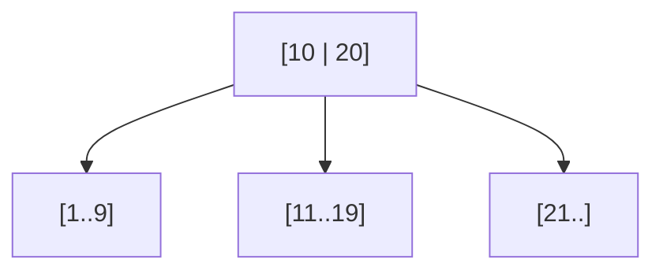

# Database Indexing

An index is a second data structure that the database maintains alongside a table. It trades write work and storage for faster reads. The useful question is not "should this column have an index?" but "which query needs this index, and what does it cost?"

## Full-table scan vs index

A table without a usable index is read row by row. For a small table that is fine. For a large one it is the difference between milliseconds and minutes.

```text
users table: 50,000,000 rows, about 500 bytes each

full scan:
  read every row -> about 25 GB -> tens of seconds on disk
index lookup:
  read a few index pages -> follow one pointer -> a few milliseconds
```

The exact timing depends on cache, disk, and row size. The shape does not: scan cost grows with table size, while index lookup grows with the height of the index, which stays small.

## B-tree vs hash

Most relational indexes are B-trees. A B-tree keeps keys sorted in a shallow tree. Each node holds many keys, so a few page reads reach any value.



A B-tree supports exact lookup, range scans, sorting by the indexed columns, and prefix matching on a composite key.

A hash index stores a hash of the key and points to the row. It gives average `O(1)` equality lookup. It cannot answer a range query or return rows in order, because hashing destroys order. Hash indexes also degrade when many keys collide, and they are less common in general-purpose relational engines.

Use a B-tree by default. Use a hash index when the workload is pure equality and the engine supports one.

## Composite indexes and column order

A composite index has more than one column. Order matters.

```text
index on (user_id, created_at)

WHERE user_id = 42 ORDER BY created_at DESC      -> served
WHERE user_id = 42 AND created_at > '2026-01-01' -> served
WHERE created_at > '2026-01-01'                  -> not served well
```

The leftmost rule: the index can be used when the query constrains a prefix of its columns. `(user_id, created_at)` is an index for user 42's recent posts. It is not an index for "all recent posts."

A covering index includes every column the query needs. The engine can answer from the index alone and skip the table fetch. That saves random reads. The cost is a larger index and more write work. Some engines express this with an `INCLUDE` clause; others require the columns in the key.

## Selectivity

Selectivity describes how sharply a predicate narrows the table. A selective predicate matches a small fraction of rows. An index on `email` or `order_id` narrows millions of rows to one. An index on `is_active`, with two values, still matches a large part of the table and often costs more than it saves.

```text
matching fraction = matching rows / total rows

email = 'a@example.com'                  1 / 50,000,000            very selective
status = 'active'                        40,000,000 / 50,000,000   not selective
```

Low selectivity is not automatically useless. A covering index can still answer a count or a filtered scan without touching the table. The query plan decides.

## What an index costs

Every index is another structure to maintain.

- **Writes**: each insert, update, and delete updates every affected index. More indexes mean more write amplification.
- **Storage**: indexes can be a large fraction of table size, especially with wide keys.
- **Memory**: hot index pages compete with data pages in the buffer cache.
- **Maintenance**: page splits, vacuum, rebuilds, and schema changes take longer.

A table with eight indexes can be several times slower to write than the same table with two. Add an index for a query that needs it, then measure the write path.

## Read the query plan

The query plan shows what the database intends to do. Look for a sequential scan on a large table, a sort that spills to disk, or a row estimate that is far from reality.

```text
Seq Scan on users  (cost=0.00..1,250,000 rows=50,000,000)
  Filter: (lower(email) = 'a@example.com')

Index Scan using users_email_key on users
  Index Cond: (email = 'a@example.com')
```

The first plan cannot use the plain index because a function wraps the column. An index on `lower(email)`, or a normalized column, would help. The second plan reads the index and then fetches the row.

Plans are estimates. Run `EXPLAIN ANALYZE` on realistic data before trusting them.

## Match indexes to the access pattern

- **Exact lookup**: B-tree or hash index on the lookup key; make it unique when the value must be unique.
- **Range**: B-tree on the range column, often with the equality column first.
- **Sort**: index in the requested order, or the database sorts after filtering.
- **Uniqueness**: unique index or constraint, with a clear error on conflict.
- **Many-to-many join**: index both sides of the join table.

Write the query first. Then add the smallest index that serves it.

## Specialized indexes

Full-text search needs an inverted index: a map from each token to the documents that contain it. That is a different structure from a B-tree, and it supports relevance ranking, stemming, and phrase queries.

Geospatial search needs a spatial index such as an R-tree or a grid of geohashes. A normal B-tree on latitude cannot answer "within five kilometers" efficiently, because latitude and longitude must be considered together.

These indexes are specialized tools. A relational database may offer them, but a dedicated search system often provides better relevance, faceting, and scale. When search is a separate system, the database remains the source of truth and the search index is a derived copy. Keep them in sync with an outbox or change stream, and accept a short delay.

## Worked example: find by email, list by user, recent posts

```text
users(id, email, display_name, created_at)
posts(id, user_id, body, visibility, created_at)

queries:
1. find a user by email
2. list one user's posts, newest first
3. list recent public posts
4. enforce one account per email
```

Indexes:

```text
users: unique (email)
  serves query 1 and query 4

posts: (user_id, created_at DESC)
  serves query 2 and the foreign-key lookup

posts: (created_at DESC) WHERE visibility = 'public'
  serves query 3 with a partial index
```

An insert into `posts` now updates two indexes. That is a deliberate trade: the feed and profile reads are frequent, and the write cost is acceptable. If the product later adds search over post bodies, that goes to a full-text index or a search service, not to another B-tree.

## Failure modes

- A function or cast on the column prevents index use: `WHERE lower(email) = ...`.
- A leading wildcard cannot use a normal B-tree: `LIKE '%term'`.
- A composite index in the wrong order serves the wrong queries.
- Duplicate indexes waste write capacity.
- An unindexed foreign key makes parent deletes scan the child table.
- Statistics are stale, so the planner chooses a bad plan.
- Too many indexes make every write slower and every migration longer.

## Curriculum note

This lesson follows a curriculum outline adapted from HelloInterview's public system design topic list. The text, examples, and diagrams are original.

## What to say in an interview

> "Users are looked up by a unique index on email, which also enforces one account per address. A composite index on `(user_id, created_at)` serves the profile timeline in order. A partial index on `created_at` where the post is public serves the global recent feed. Each index is there for a named query. I would confirm with the query plan, and I would watch write latency because posts now maintain two secondary indexes. If we add body search, that moves to a dedicated search index fed by an outbox."

That turns a list of indexes into a set of decisions with costs.
