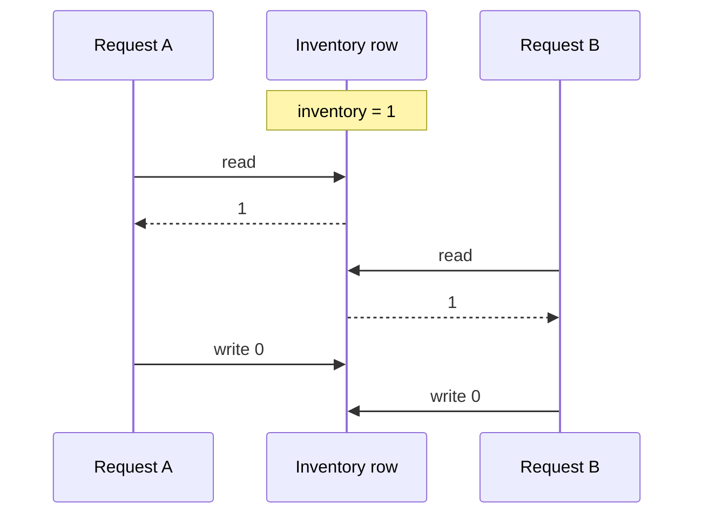
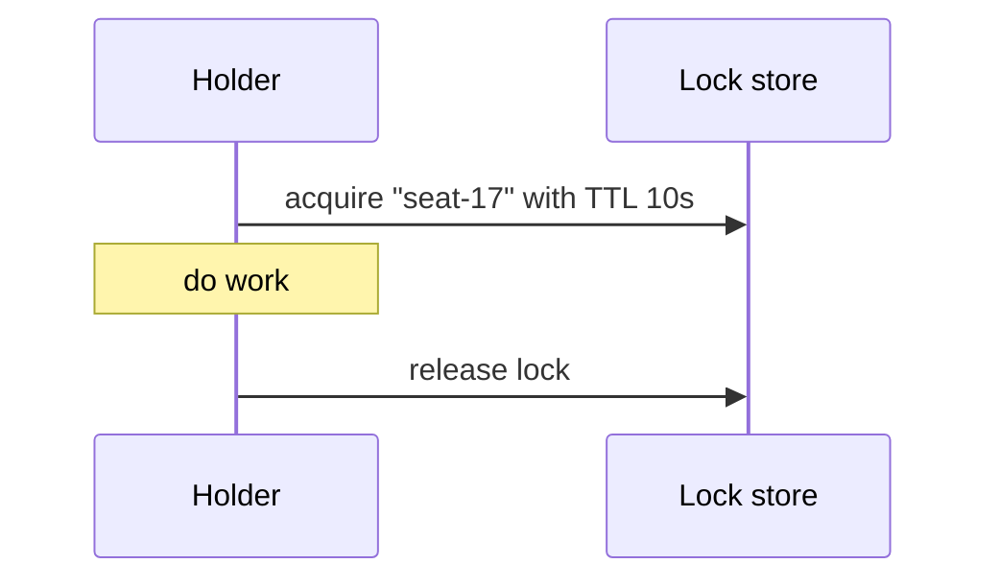
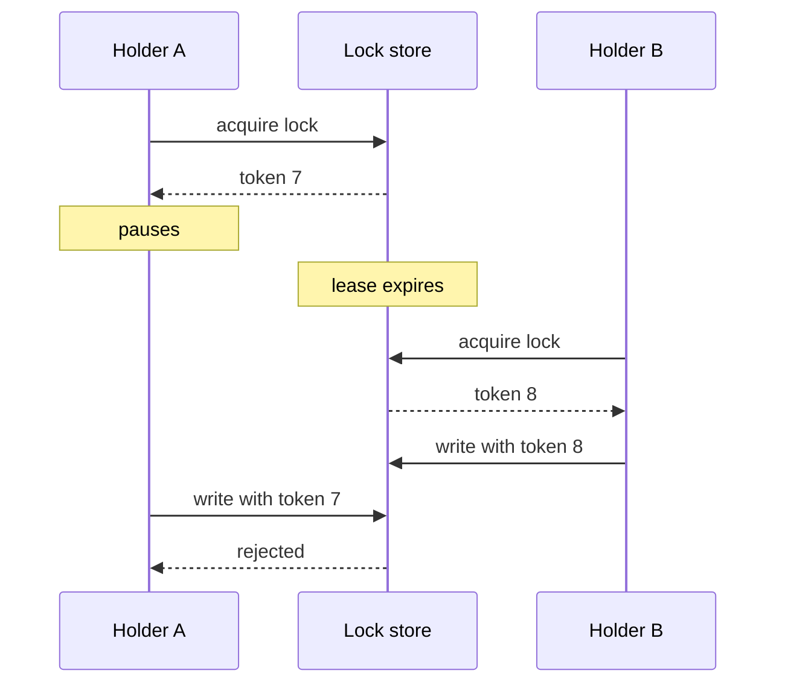
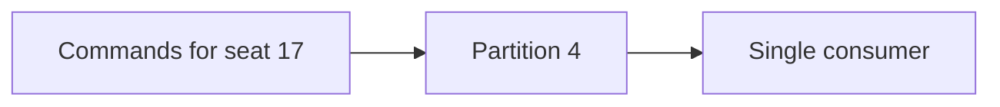
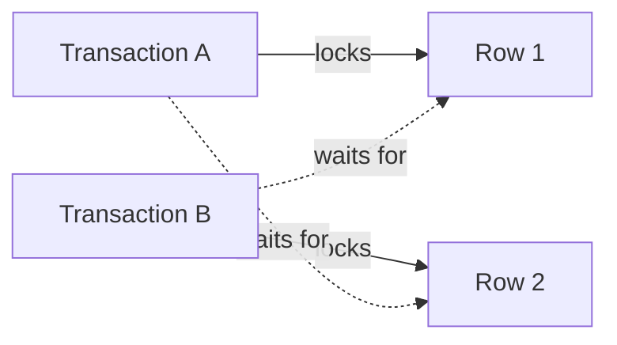

# Dealing with Contention

Contention happens when two writers want the same row, the same seat, or the same counter at the same time. The first question is not how to make it faster. It is what the correct outcome is.

_This lesson follows the Common Patterns part of a curriculum structured around the HelloInterview System Design in a Hurry outline. The explanations and examples are original._

## The lost update

The classic failure is read-modify-write without protection.



Both requests believe they sold the last item. The database recorded one decrement, but two customers have a confirmation. A lost update is a correctness bug, not a performance problem.

## Start with one atomic statement

Most contention has a simple answer in the database.

```text
UPDATE inventory
SET remaining = remaining - 1
WHERE sku = 'chair' AND remaining > 0;
```

The row lock is held for the duration of the statement, so two concurrent decrements cannot both read the old value. Check the number of affected rows. Zero means the item was already gone.

For a "create once" rule, use a unique constraint:

```text
CREATE UNIQUE INDEX one_reservation_per_seat
ON reservations (show_id, seat_id);
```

The second insert fails. Catch the duplicate-key error and return a clear conflict or show the existing reservation. The database enforces the invariant even when application code has a race.

Prefer these primitives before adding locks or coordination services. They are local, fast, and hard to bypass.

## Transactions and isolation

A transaction groups reads and writes into one unit. **Isolation** defines what concurrent transactions may see.

- **Read committed** sees only committed data, but a second read in the same transaction can see a different value.
- **Repeatable read** keeps a stable snapshot for the transaction, but write skew and phantoms may still be possible depending on the engine.
- **Serializable** makes concurrent transactions behave as if they ran one at a time. It may abort transactions and require retries.

Stronger isolation costs concurrency. Use the lowest level that protects the invariant, and state why.

Keep transactions short. Never hold a transaction open while calling a payment provider or sending an email; the locks and connections stay occupied for the whole wait.

## Pessimistic locking

Pessimistic locking assumes a conflict is likely. Take the lock before reading.

```text
BEGIN;
SELECT remaining FROM inventory WHERE sku = 'chair' FOR UPDATE;
-- check, decide, update
COMMIT;
```

The second request waits. This is easy to reason about and works well when conflicts are common and the critical section is short.

The risks are lock waits, deadlocks, and exhausted connection pools. Set a lock timeout, and keep the lock order consistent across code paths.

## Optimistic concurrency

Optimistic concurrency assumes conflicts are rare. Read a version, then write only if the version has not changed.

```text
UPDATE documents
SET body = ?, version = version + 1
WHERE id = ? AND version = ?;
```

If zero rows change, another writer won. Reread and retry, or return `409 Conflict` to the client. HTTP can express the same idea with `ETag` and `If-Match`.

This avoids holding locks between the read and the write. Under heavy contention, retries multiply and throughput falls, so cap attempts and add jitter.

## Choose between them

```text
conflict likely, work short       -> pessimistic lock or atomic update
conflict rare, work long          -> optimistic version check
invariant is "only one"           -> unique constraint
invariant spans services          -> single writer or distributed lock with fencing
```

The labels are guides. Measure the conflict rate and the cost of a retry.

## Distributed locks

A lock in one process does not protect data written by another service. A distributed lock uses a shared store with a lease.



Leases expire when a holder crashes, which is useful. They also expire when a holder pauses: a garbage collection stop, a slow disk, or a network delay. The old holder may resume after the lease is gone and write anyway.

A **fencing token** fixes this. Each acquisition gets a larger number, and storage rejects writes with a token lower than the last one seen.



Without fencing, a lease is a hint, not a guarantee. Prefer a database constraint or a single-writer partition when the invariant must be absolute.

## Serialize through a queue

Another option is to remove concurrency. Route all commands for an entity to one queue partition, and let one consumer process them in order.



This trades latency for simplicity. It works well for workflows, order state machines, and operations that already tolerate delay. It is a poor fit for a low-latency read-modify-write loop.

The queue must persist commands and handle retries. A consumer crash should not lose an accepted command.

## Contention across shards

Sharding spreads load, but it can split an invariant. If a seat and its reservation live on different shards, a local transaction cannot protect both.

Choose a shard key that keeps related rows together. Shard by `show_id` so all seats for a show share a partition. Shard by `account_id` so a balance and its ledger entries stay together.

When a cross-shard write is unavoidable, use a saga with compensating actions, or accept a short period of inconsistency with a clear repair path. Do not assume a distributed transaction is free.

## Deadlocks, expiry, and retries

A deadlock happens when two transactions each hold a lock the other needs.



Databases detect most deadlocks and abort one transaction. Retry the aborted transaction with backoff. Reduce the chance by locking rows in a fixed order and keeping transactions small.

Expiry creates a different race. A reservation hold expires while a payment is in flight. Use a state machine: `held -> confirming -> confirmed`, and let the expiry job skip rows already in `confirming`. Charge with an idempotency key so a retry does not double-bill.

## Worked example: seat booking

A booking service needs one winner per seat.

1. Client requests a hold for `(show_id, seat_id)`.
2. A transaction claims the seat row: insert it if missing, or update a row in `expired` to `held`. A unique constraint on `(show_id, seat_id)` enforces one row per seat.
3. If the claim succeeds, return the hold. If the row is `held` or `confirmed`, return `409` with the current state.
4. Payment moves the hold from `held` to `confirming`, charges with an idempotency key, then marks it `confirmed`.
5. An expiry worker moves expired holds to `expired`, and the expiry job skips rows already in `confirming`.

The unique row per seat is the core guarantee. The state machine prevents an expired hold from being confirmed. The payment idempotency key prevents a retry from charging twice.

## Worked example: limited inventory

For a flash sale, an atomic decrement handles the common case. Add a reservation row when the order needs a hold.

```text
UPDATE inventory SET remaining = remaining - 1
WHERE sku = ? AND remaining > 0;

if affected = 0: sold out
else: create order with reservation expiry
```

If the order fails or expires, return the unit with another atomic update. Track the reservation so a retry does not return stock twice.

At extreme contention, one row becomes a bottleneck. Split the count into buckets and sum them, or serialize orders for that SKU through a queue. Both add complexity; start with the single row until measurements say otherwise.

## The simplest thing that works

Contention handling has a ladder:

```text
atomic statement
unique constraint
short transaction
optimistic version check
pessimistic lock
queue serialization
distributed lock with fencing
```

Climb only as far as the invariant requires. Each step adds a failure mode, and the database primitives are usually the easiest to test.

## What to say in an interview

> "The seat invariant is enforced by a unique constraint on show and seat, inside a short transaction. Availability checks use a conditional update so the last unit cannot be oversold. Under high contention on one show, we serialize holds through a partition keyed by show ID. Distributed locks are avoided; if one is needed, it carries a fencing token."

That states the invariant, the mechanism, and the escalation path.
