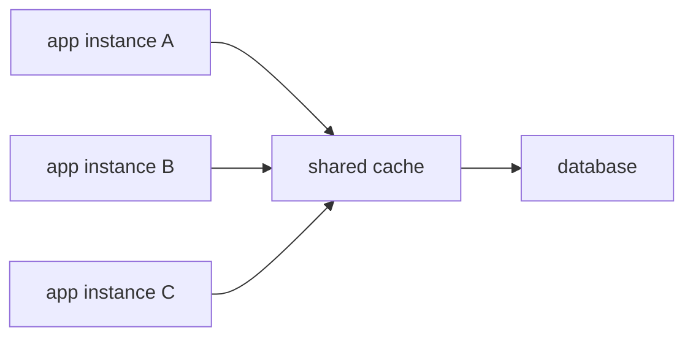
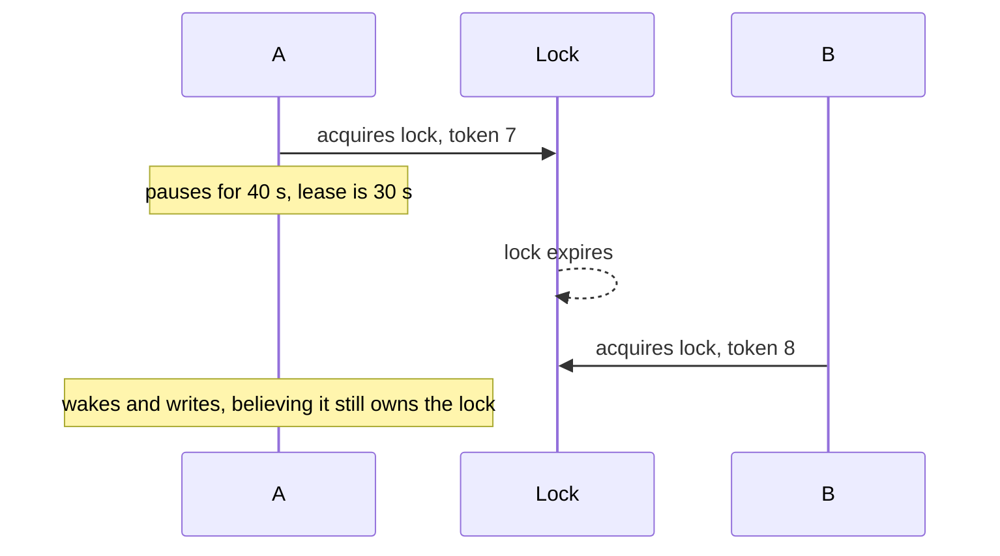
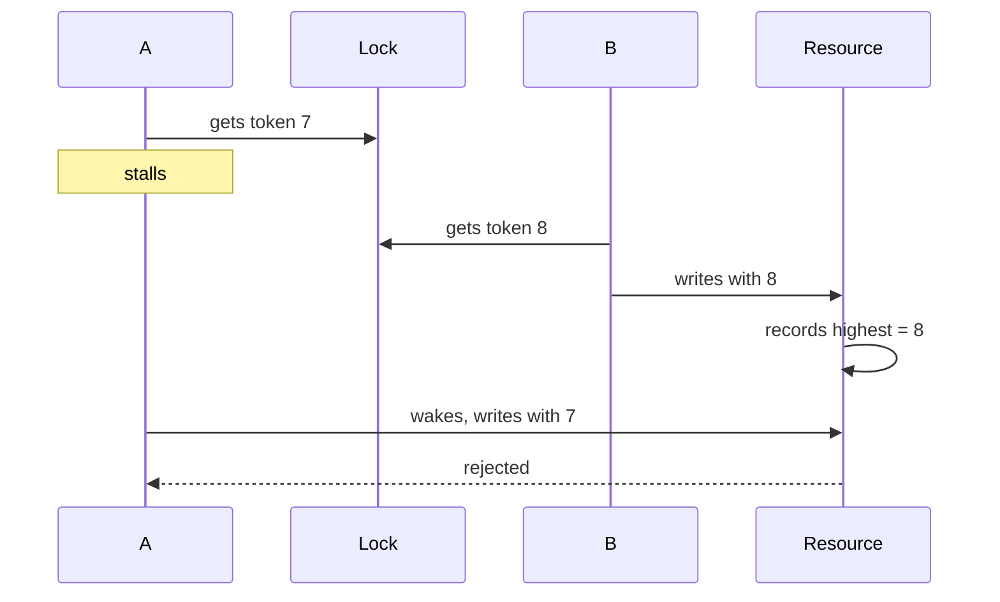

# Distributed Caches and Locks

A local hash map is fast, but each service instance has its own copy. A shared cache gives the fleet one view of hot state. A distributed lock gives one owner a short critical section. Both fail in ways that matter.

## Local versus shared caches

An in-process cache lives in the application's memory. A hit costs nanoseconds, and there is no network call. The problem is scope: ten instances hold ten copies, a write on one does not update the others, and a restart loses everything.

A shared cache lives beside the application, usually in Redis or Memcached.



A hit costs a network round trip, often under a millisecond inside one region. The benefit is one logical view for sessions, counters, and hot objects. The cache still has to be populated, invalidated, and sized.

Many systems use both layers: immutable configuration in process, mutable shared state in the external cache. Do not keep user-specific authorization decisions in a local cache without a way to revoke them.

Redis adds data structures, Lua, persistence, and replication. Memcached is a simpler cache. Durability follows the configuration, not the product name.

## Patterns and eviction

- **Cache-aside**: the application reads the cache, loads from the database on a miss, then populates the cache. Writes update the database and delete or update the key.
- **Read-through**: the cache library loads from the database on a miss. The application sees a simpler interface.
- **Write-through**: the write goes to the cache and the database together. Fresh, but every write pays both costs.
- **Write-behind**: the write lands in the cache and flushes later. Fast, with a window where a crash loses data.

Every cache needs a maximum size and eviction policy. LRU evicts the least recently used entry, LFU the least frequently used, and TTL expiry bounds staleness. Set both a TTL and a memory limit; one without the other leaves stale data or unbounded keys.

Namespace keys by version or tenant when the shape can change. Keep values small.

## Hot keys, stampedes, and outages

A hot key receives a large share of traffic. One counter for a global event or one celebrity profile can saturate a single cache shard.

Options:

- split a counter into `key:0` through `key:15` and sum the parts;
- add a short-lived local cache in front of the shared key;
- serve the hot value from read replicas;
- precompute the value and refresh it in the background.

A stampede happens when a popular key expires and many requests miss at once. They all query the database, which may be the system you were protecting.


Use single-flight population. One request takes a short lock and recomputes; the others wait, retry, or receive the stale value. Add jitter to TTLs so keys do not expire together. Serve stale while revalidating when the product allows it.

A cache outage is a capacity event. The database suddenly sees the traffic the cache was absorbing. Set short timeouts and a circuit breaker. Decide whether the feature fails open or closed: a rate limiter may fail open for reads, while a checkout session lookup may fail closed. Cap the concurrent requests that reach the database so the outage does not become a full collapse.

## Sessions and rate-limit counters

A session store maps a session id to the user, roles, and an expiry.

```text
session:8f2a -> { userId: 42, roles: [member], expiresAt: ... }
```

Logout deletes the key. A TTL enforces an idle timeout. If the cache loses data, users are logged out; decide whether that is acceptable.

Rate limiting uses shared counters. The increment and expiry must be atomic, or a crash between them leaves a key with no TTL.

```lua
local n = redis.call('INCR', KEYS[1])
if n == 1 then
  redis.call('EXPIRE', KEYS[1], ARGV[1])
end
return n
```

A global counter can be a hot key, so shard it and accept slight over-admission. A lost increment is usually fine for a rate limit, not for a ledger.

## Distributed locks

A distributed lock lets one process hold a named lease during a short critical section. Typical uses are leader election and stopping duplicate cron runs.

With Redis, acquire with a unique token and an expiry:

```text
SET lock:job42 <token> NX PX 30000
```

`NX` means the key must not already exist. `PX` sets a 30-second lease. The token proves ownership at release time.

```lua
if redis.call('GET', KEYS[1]) == ARGV[1] then
  return redis.call('DEL', KEYS[1])
else
  return 0
end
```

Without the token check, a holder whose lease expired could delete the next holder's lock.

## Expiry, pauses, and fencing

The hard failure is a holder that pauses longer than the lease. A garbage collection pause or network partition can keep the process alive while the lease expires and a second holder enters.



Mutual exclusion is broken. The fix is a **fencing token**. The lock service issues a monotonically increasing number on every acquisition. The holder sends that number with each write, and the resource rejects a token lower than the highest one it has seen.



A lock without fencing protects against accidental overlap, not against a stale holder.

Redis Redlock acquires a lock on a majority of independent Redis nodes. It reduces the chance of two locks from one failed node, but it depends on timing and provides no consensus during a partition. ZooKeeper and etcd use a quorum, ephemeral nodes or leases, and watches. They fit coordination that is central to correctness, but the protected resource still needs a fencing check.

Deadlocks happen when a process holds one lock and waits for another. Acquire in a fixed order, use a bounded wait, retry with backoff, and keep the critical section short.

## When a lock is the wrong tool

A lock is not a workflow engine. Long-running work, human approval, and multi-step external calls can outlive any sensible lease. Lease renewal helps, but no lease makes an external side effect atomic.

Use a database transaction or a unique constraint when the invariant lives in one database. Use an idempotency key when a client may retry. Use a queue with one consumer per partition when work should be serialized. Use a lock only for a short section where coordination through the database is awkward.

Seat reservation shows the difference. A unique constraint does the job:

```text
INSERT INTO reservations (seat_id, show_id, user_id)
VALUES (17, 9001, 42);

UNIQUE (seat_id, show_id)
```

One insert wins. The second gets a duplicate-key error and returns 409. No cache lock is required. If seats are sharded, route by show or seat so one database owns the invariant.

A lock-based version acquires the seat lock, checks availability, inserts, and releases. If the lock expires mid-flight, or the cache is partitioned, two users can still insert. The lock reduces contention; the constraint is the final guard.

The same reasoning applies to payments. A distributed lock around a charge does not make the bank call and the ledger write atomic. A transaction, an idempotency key, and a unique ledger entry do.

## Worked rate limiter

A shared bucket uses one key per user and window. A Lua script increments the counter atomically and sets the TTL on the first request. At 1,000 requests per second, a global key is hot, so shard the counter by bucket and sum the parts. Accept that the limit is approximate.

If Redis is unavailable, fall back to a smaller local bucket per instance. The effective limit becomes the sum of local limits, so set it conservatively. State whether the limiter fails open or closed.

## What to say in an interview

> "Sessions and rate-limit counters live in a shared Redis cache with TTLs and atomic Lua updates. Cache-aside protects the database, with single-flight population and jittered TTLs for hot keys. We use a distributed lock only for short leader tasks, with a ten-second lease and a fencing token checked by the resource. Seat booking does not use a lock: a unique constraint on seat and show decides the winner. Long workflows use idempotent steps and a queue, not a lease."

That separates shared fast state from correctness, and it names the failure mode that each mechanism does not solve.
