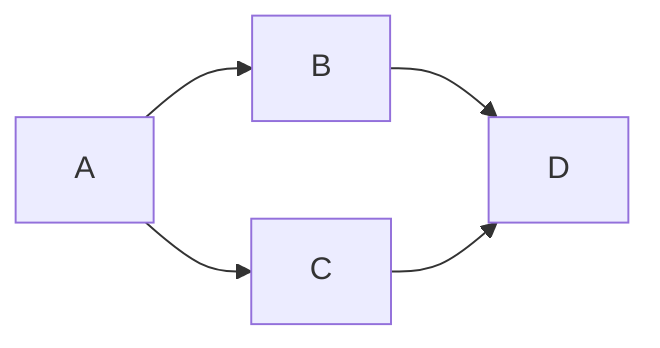
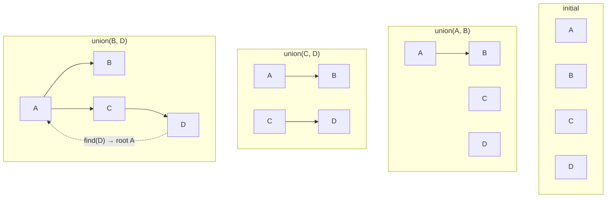

# Topological Sort and Union-Find

Some graph problems are not about the shortest path. They are about **order** or **belonging**.

## Topological order

A topological order lists nodes so that every directed edge points from earlier to later.



```text
valid orders:
A, B, C, D
A, C, B, D
```

This is the order you need when tasks have prerequisites. **Build Order** asks whether such an order exists, returning a boolean. The same Kahn traversal can produce the sequence if the problem asks for one.

A graph with a cycle has no topological order. If `A` depends on `B` and `B` depends on `A`, neither can go first.

## Kahn's algorithm

Kahn's algorithm repeatedly takes a node with no remaining prerequisites.

```text
indegree:
A: 0
B: 1  (A)
C: 1  (A)
D: 2  (B, C)
```

```text
queue = [A]
order = []

pop A, append A
  B indegree -> 0, enqueue B
  C indegree -> 0, enqueue C

pop B, append B
  D indegree -> 1

pop C, append C
  D indegree -> 0, enqueue D

pop D, append D
```

If the order contains all nodes, the graph is acyclic. If some nodes remain, they are part of a cycle.

The cost is `O(V + E)`: every node enters the queue once and every edge is examined once.

## Union-find

Union-find (also called disjoint set union) answers:

- Are `A` and `B` in the same group?
- Merge the groups containing `A` and `B`.

Each group has a representative root node. `find` walks to the root. `union` attaches one root under another.



A naive tree can become a long chain. Two optimizations fix that:

- **Path compression**: during `find`, point every visited node directly at the root.
- **Union by rank or size**: attach the smaller tree under the larger one.

With both, operations are `O(α(n))` amortized, which is effectively constant.

## When to use which

Use **topological sort** when direction matters and you need an order.

- Build order.
- Course prerequisites.
- Task scheduling with dependencies.
- Detecting a cycle in a directed graph.

Use **union-find** when you only care about connectivity.

- Counting connected components.
- Merging accounts that share an email.
- Kruskal's minimum spanning tree.
- Checking whether adding an edge creates a cycle in an undirected graph.

Union-find does not preserve distances or paths. If the question asks "how far" or "which route," use BFS, DFS, or a shortest-path algorithm instead.

## The one-line distinction

> Topological sort answers "what order?" Union-find answers "same group?"

If you can name which of those two questions the problem is asking, the algorithm choice is usually settled.
