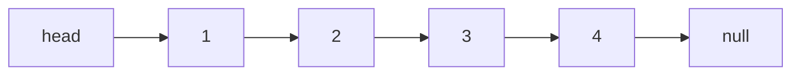
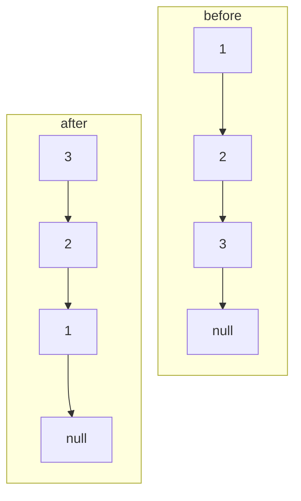
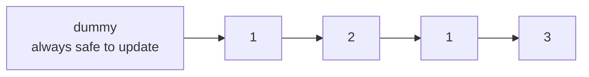
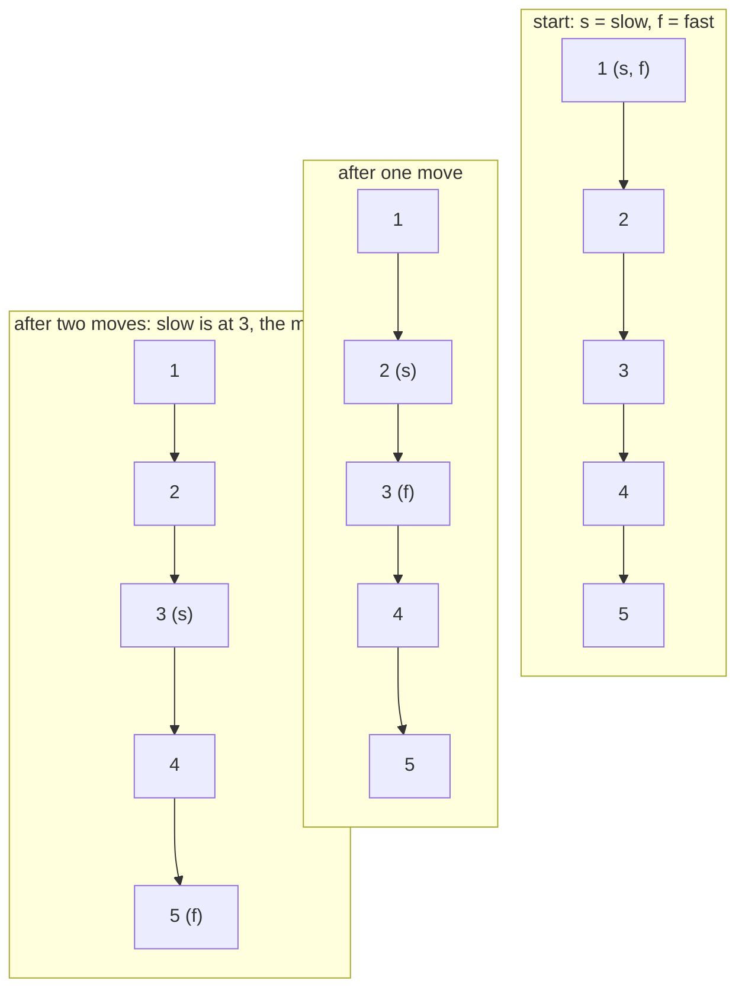
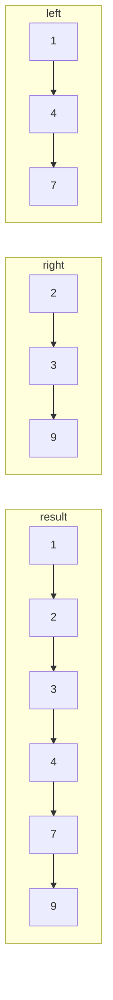

# Linked Lists

An array is a row of boxes. A linked list is a treasure hunt: each clue tells you where the next clue is.



Each node holds a value and a `next` pointer. There is no index arithmetic, so getting to position 3 means following three pointers.

## Reversing a list

The classic exercise asks you to reverse the arrows.



You need three pointers because once you change `current.next`, you lose the rest of the list unless you saved it.

```text
previous = null
current = head

while current is not null:
    next = current.next   # save the rest
    current.next = previous
    previous = current
    current = next

return previous
```

Step by step:

```text
p=null  c=1 -> 2 -> 3

save next=2
1.next = null
p=1, c=2

save next=3
2.next = 1
p=2, c=3

save next=null
3.next = 2
p=3, c=null

return 3 -> 2 -> 1 -> null
```

This is `O(n)` time and `O(1)` extra space.

## The dummy node

Suppose you need to remove all nodes with a certain value. If the head matches, you have to change the head. If it does not, you change a middle pointer. Two cases invite bugs.

A dummy node gives every real node a predecessor:



Build the result after `dummy`, then return `dummy.next`. The same trick helps when merging lists or building a new list from parts.

## Fast and slow pointers

Two walkers start at the head. One moves one node at a time; the other moves two.



If the list has a cycle, the fast pointer eventually laps the slow pointer and they meet. If it does not, the fast pointer reaches null. This is Floyd's cycle detection and needs no visited set.

## Merging two sorted lists

Keep a `tail` pointer at the end of the merged result. Compare the two heads, attach the smaller one, and advance that list. When one list runs out, attach the rest of the other.



The merge is `O(n + m)` time and `O(1)` extra space because it relinks existing nodes. This is the same merge step used by merge sort.

## Pointer hygiene

Before you change a pointer, answer two questions:

1. Which nodes do I still need later?
2. Have I saved a reference to them?

If the answer to the first is "the rest of the list" and the second is "no," save `current.next` first. Most linked-list bugs are lost references, not complicated logic.
