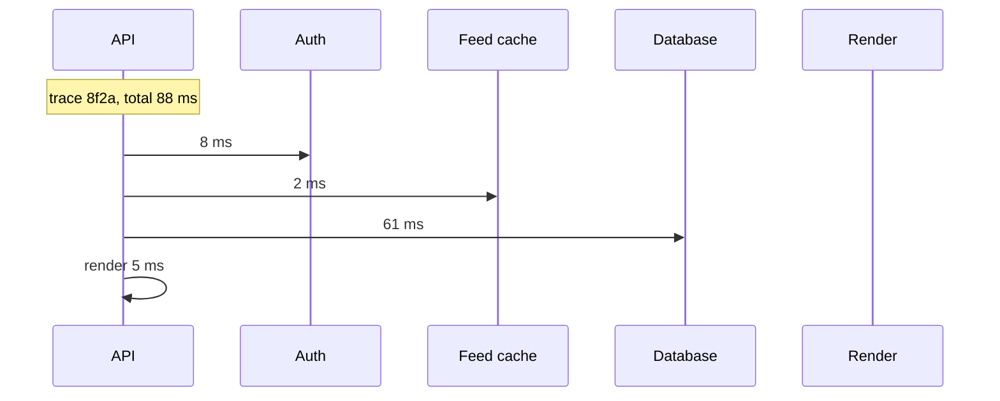

# Observability and Operations

A system should explain what it is doing before an incident forces you to guess. Observability is the ability to ask new questions about production without shipping new code. Operations is the practice of using those answers to keep the service healthy.

## Three signals

- **Metrics** are numbers over time: request rate, error count, latency, queue depth. They are cheap to store and good at showing a trend.
- **Logs** are structured events with context: request id, user or tenant, operation, result. They are detailed and expensive at volume.
- **Traces** follow one request across services, with a span for each hop.



A correlation id ties the three together. The trace shows where the time went. The metric shows whether the problem affects everyone. The log explains the specific failure. Without a shared id, you have three unrelated piles of data.

## Metrics and methods

Use the right metric type. A counter only increases, such as requests served. A gauge goes up and down, such as connections open. A histogram records a distribution, which is what you need for latency percentiles.

Two methods cover most services:

- **RED** for request-serving: rate, errors, duration.
- **USE** for resources: utilization, saturation, errors.

```text
API requests/s       12,400
5xx rate              0.4%
p99 latency           820 ms
database CPU           71%
queue oldest age        4 s
```

Add business metrics that connect technical health to product outcomes: signups completed, payments captured, messages delivered, files synced. A service can look healthy while the business flow is failing.

Watch label cardinality. A label such as `user_id`, `request_id`, or a raw URL path creates a new time series per value and can overwhelm the metric store. Keep labels bounded to route, status code class, region, and tenant tier. Use logs or traces for per-user detail.

## Latency percentiles

An average hides the requests users remember. Consider 100 requests:

```text
90 requests at   50 ms
 9 requests at  200 ms
 1 request  at 5000 ms

average = 113 ms
p50     =  50 ms
p95     = 200 ms
p99     = 5000 ms
```

The average looks fine. The slowest user waited five seconds. Report p50 for the typical experience and p95 or p99 for the tail.

Tail latency gets worse with fan-out. If a page calls 20 services and each one is slow 1% of the time, the chance that at least one is slow is about 18%:

```text
1 - 0.99^20 = 0.182
```

That is why a service with a good p99 can still produce a slow page. Set timeouts, limit parallel fan-out, and use hedged requests only when the duplicate work is safe.

Do not average p99 values from individual instances. Merge the underlying histograms, or compute a weighted result. Averaging percentiles produces a number that describes no real user.

## SLOs and error budgets

An **SLI** is a measurement, such as the share of checkout requests that succeed under one second. An **SLO** is the target for that measurement, such as 99.9% over 30 days. An **SLA** is an external contract with consequences.

The error budget is the gap between the SLO and 100%. At 99.9% over 30 days, the budget is about 43 minutes of full outage, or an equivalent amount of partial failure.

```text
30 days = 43,200 minutes
budget  = 0.1% = 43.2 minutes
```

A burn rate of 1x uses the budget evenly across the window. A rate of 14.4x uses 2% of the budget in one hour. A common alerting setup pages on fast burn and opens a ticket on slow burn. Multi-window checks reduce noise: a short window catches a sharp failure, and a longer window confirms it is sustained.

The budget also guides releases. If the service is burning budget quickly, slow feature launches and fix reliability first. If the budget is healthy, ship.

## Alerting on symptoms

Alert on what users feel, not on every internal cause. CPU at 70% may be normal. A rising checkout error rate is not.

```text
bad:  CPU > 70% for 5 minutes
good: checkout 5xx > 2% for 5 minutes
      and p99 > 1 second
```

Cause-based alerts still have a place when saturation predicts an outage, such as a disk that will fill in an hour. Keep them separate from symptom pages and route them to the team that can act.

Every alert needs an owner, a severity, and a runbook. An alert without an action is noise, and noise trains people to ignore pages. Use a duration or multi-window condition to avoid flapping, and review alert frequency after each incident.

## Dashboards and tracing

A useful dashboard set has three levels:

- **Overview**: SLO status, traffic, error rate, latency, saturation.
- **Service**: endpoint latency, dependency calls, instance health, deploy markers.
- **Dependency**: database, cache, queue, and third-party provider health.

Keep dashboards stable so people can find the same panel during an incident. Link each panel to a runbook.

Distributed tracing propagates a trace id and span id through every call. A span records a name, start time, duration, status, and attributes such as tenant or database statement class. Sampling keeps cost down. Head sampling decides at the start and may miss rare failures. Tail sampling buffers a trace and keeps errors and slow requests, which is often more useful for debugging.

Exemplars connect a metric spike to a specific trace, so an alert can lead directly to an example request.

## Queues and worker health

Queue depth alone can mislead. A queue that grows because traffic doubled may drain normally. A queue with a stable depth but rising message age is already delivering late.

Track:

- publish rate and consume rate;
- oldest message age;
- retry rate and dead-letter count;
- processing duration;
- worker concurrency and saturation.

Little's law gives a capacity estimate: the number of in-flight messages equals arrival rate times time in system. At 1,000 messages per second and 0.2 seconds of processing, about 200 messages are in flight. If workers can handle 150, the queue age will grow even if depth looks modest.

Alert on age or projected drain time, not only depth. A dead-letter queue that receives a message is a signal with a person attached, not a silent trash can.

## Incidents and operations

A runbook should state the symptom, the dashboards to open, the likely causes, the immediate mitigations, the rollback step, and the escalation path. During an incident, assign a commander, a communications owner, and an operator. Keep a timeline of decisions, not only symptoms.

After the incident, write a blameless postmortem: impact, detection, contributing factors, what went well, and action items with owners and dates. The goal is a safer system, not a person to blame.

Operational safety also includes:

- canary deploys and feature flags;
- backward-compatible migrations;
- tested rollback;
- restore drills, because an untested backup is only a hope;
- load tests with realistic data sizes.

## Cost and retention

Observability has a bill. Logs are usually the largest line. Keep hot logs for days or weeks, archive cold logs for compliance, and sample debug logs. Metrics cost grows with cardinality and retention. Traces cost grows with sampling rate and span count.

Set retention per signal, not one policy for everything. A payment audit log and a debug request log do not need the same lifetime.

## What to say in an interview

> "For a payment ledger I would track authorization success rate, p99 charge latency, ledger write failures, settlement queue age, and reconciliation mismatches. Page on error-budget burn, sustained p99 above one second, and settlement lag over five minutes. Dashboards show database saturation, provider error breakdown, and queue drain time. Every alert links to a runbook with rollback and replay steps, and traces carry a correlation id across the API, ledger, and settlement worker."

That names the user-facing signals, the targets, the alert conditions, and the operational response. It also shows what you would ignore until it becomes a symptom.
