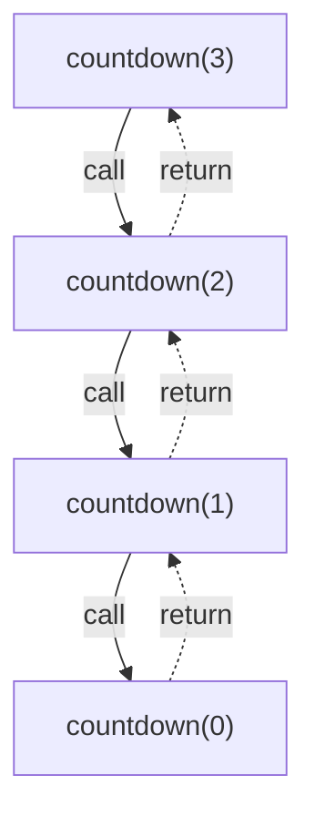
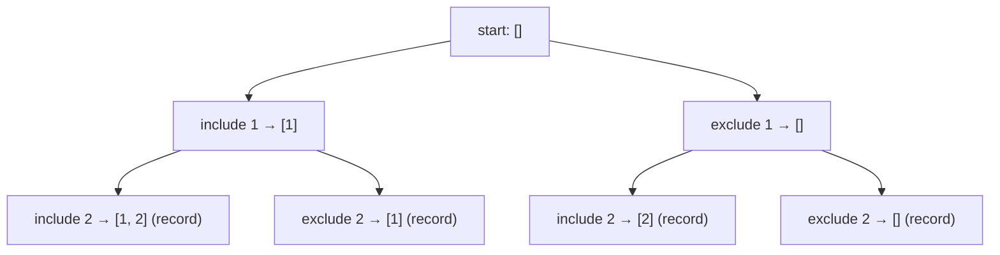
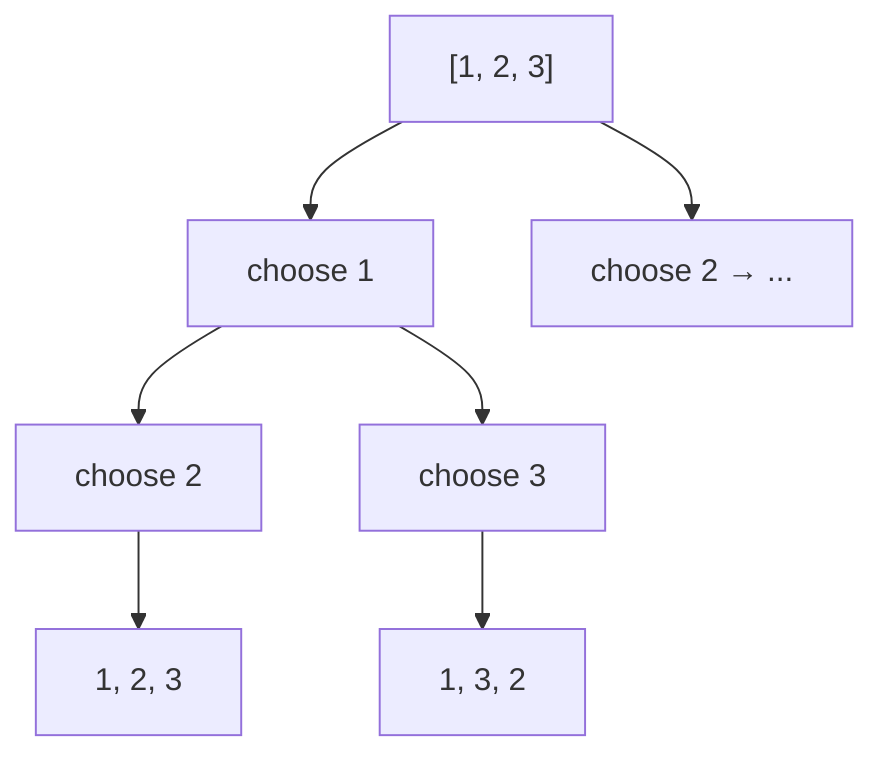

# Recursion and Backtracking

Recursion is a function that calls itself on a smaller version of the same problem. Backtracking is recursion that tries a choice, explores it, and then undoes it.

## The two required parts

Every recursive function needs:

1. **A base case** that returns without recursing.
2. **A recursive case** that makes the problem smaller.

```text
countdown(n):
    if n == 0:          # base case
        return
    print(n)
    countdown(n - 1)    # smaller problem
```

If the input does not get smaller, the calls never stop and the stack runs out of room.

## The call stack

Each call waits for the next one to finish.



The maximum number of waiting calls is the depth. That is why a recursive solution has `O(depth)` space even if it creates no arrays.

## Choose, explore, unchoose

Backtracking explores a decision tree. At each node, you make a choice, recurse, and then undo the choice.

Subsets of `[1, 2]`:



The shape:

```text
path.append(choice)
explore(next position)
path.pop()
```

If you forget `pop`, the path leaks into sibling branches. If you store `path` directly in the result list, every recorded answer points at the same mutable list. Store a **copy**.

## Permutations

For permutations, order matters, so you need to know which values are already used.



Use a `used` array or swap values in place. Swapping avoids an extra array but makes the undo step explicit.

## Pruning

Backtracking can be enormous. Pruning removes branches early.

**Sum Combinations** asks for combinations that add to a target. Once the running sum exceeds the target, stop exploring that branch. If the candidates are sorted, you can also stop when the next candidate is too large.

```text
candidates: [2, 3, 5], target: 8

[2, 2, 2, 2] = 8  -> keep
[2, 2, 3] = 7     -> continue
[2, 2, 5] = 9     -> too large, stop
```

No matter what comes after `5`, adding more positive values cannot bring the sum back down. The branch is dead.

## Recursion is a tool, not a requirement

Any recursion can be rewritten with an explicit stack. Sometimes that is clearer; sometimes it is worse. Use recursion when the problem naturally splits into smaller copies, and use an explicit stack when you need to pause, resume, or limit depth.

In an interview, say what each recursive call represents. "This call returns the number of ways to climb the remaining stairs" is much clearer than "this function recurses on i + 1."
