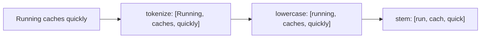
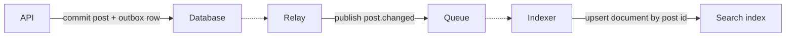
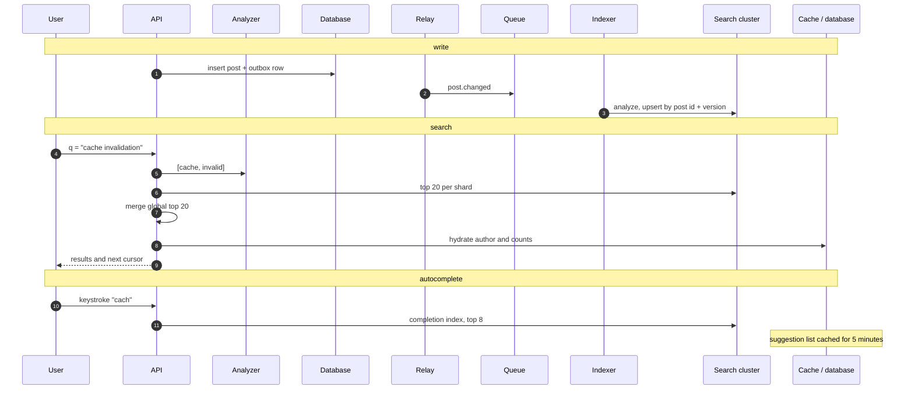

# Search-Optimized Databases

A normal database index finds exact values and ranges. It does not understand words. When users expect to type a phrase and get ranked results, the access pattern has changed enough to need a search index.

## When a normal index stops helping

A B-tree index is sorted by key. It accelerates equality, ranges, and anchored prefix matches.

```text
WHERE email = 'sam@example.com'     -> index seek
WHERE created_at >= '2026-11-01'    -> index range
WHERE name LIKE 'ann%'              -> index range
WHERE body LIKE '%database%'        -> full scan
```

The leading wildcard hides the start of the value, so the index cannot seek. At 50 million posts, a scan per search is not viable. A normal index also has no notion of stemming, typo tolerance, phrase proximity, or relevance.

## The inverted index

A search index flips the mapping. It goes from a term to the documents that contain it.

```text
d1: distributed caches reduce latency
d2: cache invalidation is hard
d3: latency budgets and caches

cache   -> d1, d2, d3
latency -> d1, d3
hard    -> d2

query "cache latency"
  -> postings for cache:   d1, d2, d3
  -> postings for latency: d1, d3
  -> intersection:         d1, d3
  -> rank the two matches
```

Postings usually store a document id, term positions, and term frequency. Positions support phrase queries such as `"cache invalidation"`. The index is a second copy, so it costs disk and memory. Positions and doc values can make it larger than the source text when there are many fields.

Writes pay for analysis and postings updates. Reads pay for walking postings lists and merging scores.

## Analysis: turning text into terms

An analyzer runs a character filter, tokenizer, and token filters. A common chain lowercases text, removes punctuation and stop words, and stems words to a root.



Index-time and query-time analyzers must agree. If the index stores stems and the query sends raw words, matches disappear. Language analyzers handle plurals and accents differently, and mixed-language content needs a plan.

Use a text field for prose and a keyword field for exact values such as tags, emails, and ids. Define the important fields up front; changing an analyzer often needs a full reindex.

## Relevance ranking

Matching is only half the job. Ranking decides which match appears first.

BM25 is a common scoring function. It rewards a term that appears often in a document, gives rarer terms more weight, and normalizes for document length so long posts do not win by volume. On top of that score, you can boost fields and business signals:

```text
score = text_score
      + 3.0 * title_match
      + 1.5 * recent_within_7_days
      + 0.5 * author_is_followed
```

Those weights are product policy. Measure them against real queries and clicks. Correct documents in a poor order still feel broken.

## Typos and autocomplete

Fuzzy matching allows a small edit distance, such as one insertion, deletion, or substitution. Implementations use a Levenshtein automaton or an n-gram index to avoid comparing the query with every term. More allowed edits and shorter prefixes create many candidates, so cap the expansion.

Autocomplete is a prefix problem, not a full search problem. A completion index stores popular terms or documents by prefix and returns a small top-k list.

```text
prefix "data" -> database, data modeling, data warehouse
prefix "datb" -> database (one edit)
```

Rank suggestions by popularity, recency, and the current user's history. Cache the top suggestions briefly. The completion index costs memory, and a viral term creates a hot key, but five-minute staleness is usually acceptable.

## Choosing a search system

- **Elasticsearch or OpenSearch**: distributed inverted index, analyzers, aggregations, and shards. Powerful and operationally heavy. Managed offerings reduce the cluster work but not the cost.
- **Database full-text search**: PostgreSQL `tsvector` with a GIN index, for example. It stays in the same transaction as the data. Ranking, fuzzy matching, and horizontal scale are more limited.
- **Managed search services**: a hosted index with less operational control. Check limits, latency, and egress pricing.
- **Plain SQL**: fine for small tables, exact filters, and anchored prefixes. A search cluster for ten thousand rows is usually overkill.

The search index is a derived copy, not the source of truth. The transactional database still owns the record and its permissions.

## Keeping the index current

The reliable path is to commit the change and an event in one database transaction, then let a relay publish the event.



Change data capture is an alternative. The indexer reads the database replication log and turns row changes into index updates. Both paths are asynchronous and usually at-least-once, so make the upsert idempotent. Store a document version and ignore an event that is older than the version already indexed. Deletes need a tombstone event, and a periodic reconciliation job catches missed changes.

The trade-off is freshness. Synchronous dual writes make the request slower and can still disagree when one write fails. Asynchronous indexing usually lags by seconds. Say the window and what the user sees. If a user creates a post and immediately searches for it, they may not find it. Options are to wait, query the primary for that user's recent items, or index critical content synchronously.

## Shards, replicas, and reindexing

Shard by document id to spread writes and reads. Routing by tenant keeps one tenant's query on one shard, but a large tenant becomes a hot shard. Replicas add read capacity and a failover target. Each replica multiplies index storage.

Some systems fix the shard count at creation. Over-sharding adds overhead; under-sharding limits parallelism.

A mapping or analyzer change often needs a new index. Build it beside the old one, backfill historical documents, replay changes, then move an alias to the new index.

```text
posts-v1  <-- reads
posts-v2  <-- backfill, then replay, then alias switch
```

Reindexing needs double storage and time, and it competes with live traffic. Throttle the backfill and watch index latency. Deep pagination has a similar cost: `from + size` grows expensive, so use a `search_after` cursor for large result sets.

## Worked post search and autocomplete

Assume 50 million new posts per day, 2 KB of indexable text each, and a 30-day search window. The raw index is about 100 GB per day, or 3 TB for the window. One replica doubles it to 6 TB before overhead.



If the search cluster is unavailable, fall back to a limited database query over recent or title fields and mark the response as degraded. If the index lags, show recent database results beside search results. If a document keeps failing to index, send it to a dead-letter queue with the source id.

## Failure modes and trade-offs

- **Index lag**: searches miss new content. Accept it for a feed, and avoid it for a payment lookup.
- **Lost index write**: the database commit succeeds and the index update does not. The outbox or CDC path plus reconciliation is the repair.
- **Duplicate delivery**: an idempotent upsert and a version guard prevent older data from overwriting newer data.
- **Mapping explosion**: dynamic fields create too many indexed fields. Define a schema and a field limit.
- **Heavy aggregations**: analytics queries compete with user search. Isolate them or precompute results.
- **Permission leaks**: filter by tenant and access control at query time, not only when the document is indexed.

## What to say in an interview

> "Post search uses a derived index. A post commits to the database with an outbox row, a relay publishes the change, and an idempotent indexer upserts it by post id and version. Queries are analyzed, matched through an inverted index, and ranked with BM25 plus a recency boost. Index lag stays under five seconds, and if the cluster is down we fall back to a limited database search. Autocomplete comes from a completion index with a short cache, not from the main search path."

That covers the index model, freshness, ranking, fallback, and the boundary between search and the source of truth.
