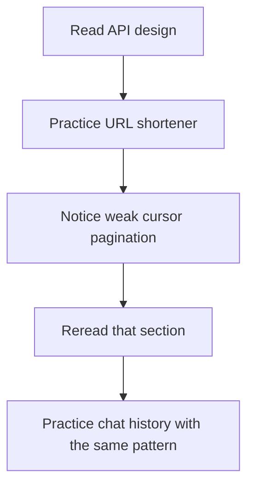

# How to Prepare for System Design Interviews

Preparation is not a reading project. It is a loop: learn a small amount, use it under time pressure, then review what broke. The structure of this curriculum follows the public HelloInterview outline; the explanations and examples here are original.

## Pick a path that fits your calendar

The right plan depends on how much time you have.

- **Three to four weeks, new to system design.** Spend the first week on the delivery framework and core concepts. Use the second week for one design every two days. Use the third week for mocks and review. Keep the last few days light.
- **Under one week, experienced engineer.** Take one diagnostic design, read the rubric, then run three timed sessions on unfamiliar prompts. Spend the remaining time on your two weakest areas, not on new technologies.
- **Interview in two or three days.** Learn the delivery framework, practice one end-to-end design aloud, and run one mock. Focus on clear requirements, a small API, a simple diagram, and honest trade-offs. Breadth can wait.

A short plan with real practice beats a long plan that never leaves the reading phase.

## Build the foundation in order

The topics depend on each other. Skipping ahead makes later lessons feel like memorization.

```text
1. delivery framework
   clarify, estimate, API, data, sketch, deep dive, failure, trade-offs

2. core concepts
   requirements, API design, data modeling, caching, databases,
   queues, scaling, consistency, security

3. key technologies
   load balancer, cache, queue, object store, search index, CDN

4. recurring patterns
   fan-out, sharding, idempotency, rate limiting, replication,
   change data capture, sagas
```

The delivery framework gives you somewhere to put each idea. Core concepts explain why a component exists. Key technologies are the tools you may name. Patterns are the shapes that repeat across prompts.

Do not collect product names. If you cannot say what job a component does, leave it out of the diagram.

## Run the practice loop

One practice rep has five steps.

1. **Pick a prompt.** Prefer one you have not seen. The eight design scenarios in this app cover lookup, write coordination, fan-out, and durability.
2. **Write requirements and estimates.** Spend five minutes. List three to five user flows, two or three numbers, and what is out of scope.
3. **Attempt the design on a whiteboard or blank page.** Talk aloud for twenty to twenty-five minutes. Draw the main path before adding components. Mark the one or two areas you would deep dive.
4. **Read the reference or rubric after the attempt.** Compare decisions, not drawings. Ask which requirement you missed, which bottleneck you ignored, and which trade-off you failed to name.
5. **Run a peer mock.** A second person catches vague claims, hand-waving, and time management problems that self-review misses.

The order matters. Reading a reference before an attempt creates a feeling of familiarity that disappears when the page is blank. Struggle first, then compare.

## Use the lessons and the eight designs together

Read a concept lesson when a practice rep exposes a gap. Then return to a prompt and use the idea.



The eight design scenarios fall into rough groups:

- **Lookup and read paths:** URL shortener, search autocomplete.
- **Write coordination:** rate limiter, seat reservation.
- **Fan-out and messaging:** news feed, chat system.
- **Durability and synchronization:** payment ledger, file sync.

Practice at least one from each group. Interviewers often combine them. A ticketing flow contains a seat reservation, a payment, and a notification feed.

## Avoid passive reading

Passive reading feels productive because the material is clear. Recognition is not recall.

Signs that a study session was passive:

- You highlighted a lesson but did not draw the system.
- You watched a walkthrough and nodded at each step.
- You read three designs and could not reproduce one API from memory.
- You know the name of a pattern but cannot give an example or a failure mode.

Replace reading with retrieval. Close the lesson and write the framework from memory. Explain a cache invalidation rule to an imaginary colleague. Draw the write path for a payment before opening the reference.

## Track weak patterns

Keep a short log after every rep.

```text
date | prompt           | weak area              | next action
-----+------------------+------------------------+----------------------
11/2 | news feed        | fan-out estimate       | redo QPS math
11/4 | payment ledger   | idempotency race       | reread retry section
11/6 | seat reservation | double-booking failure | add unique constraint
```

Look for repeats. A weak area that appears three times is a study topic. A mistake that appears once may be noise.

Common weak patterns:

- estimates with no peak multiplier or storage unit;
- APIs with verbs in the path and no pagination;
- data models with no key for the main query;
- diagrams with components but no labeled data flow;
- failure sections that stop at "add a replica";
- trade-offs that list benefits but no costs.

Spend two reps on the weakest pattern before adding a new design.

## A worked ten-day plan

Suppose an experienced engineer has ten days and two hours per day.

```text
days 1-2   framework, requirements, estimation
day 3      URL shortener, timed
day 4      review and repeat weak sections
day 5      rate limiter, timed
day 6      news feed, timed
day 7      review log; peer mock
day 8      payment ledger, timed
day 9      second mock; fix two gaps
day 10     light review, rest
```

The plan leaves room for review. A schedule with seven new designs and no review produces seven shallow memories.

The trade-off is breadth versus depth. Covering every prompt builds exposure. Repeating a few prompts builds judgment. Most candidates benefit from a mix: a broad first pass, then two or three repeat reps on the areas that stay weak.

## The week of the interview

- Run at most two or three mocks. More will add fatigue, not skill.
- Do not start a new topic after the midpoint of the week.
- Review your weak-pattern log and one page of numbers.
- Rehearse a two-minute opening: clarify, state assumptions, outline the plan.
- Prepare two questions about the team and the systems they run.
- Protect sleep. A tired explanation of a cache is worse than a polished explanation of a simpler design.

The day before, do a short warm-up. Draw one architecture from memory, say the trade-offs aloud, and stop.

## What to say in an interview

> "I use a repeatable structure: clarify the users and flows, estimate the load, define a small API and data model, sketch the main path, then deep dive on the riskiest part. I state my assumptions and the trade-offs I accept. If we have time, I cover failure modes and what I would change at ten times the scale."

That answer shows a process you can repeat under pressure, which is the point of preparation.
