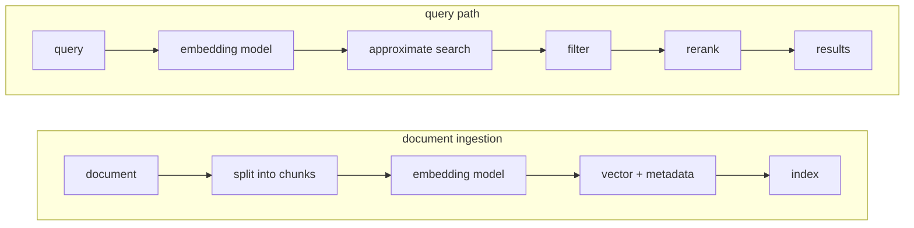
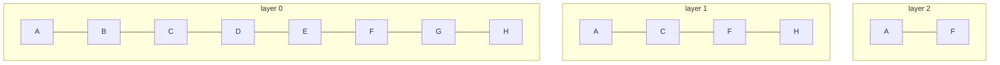
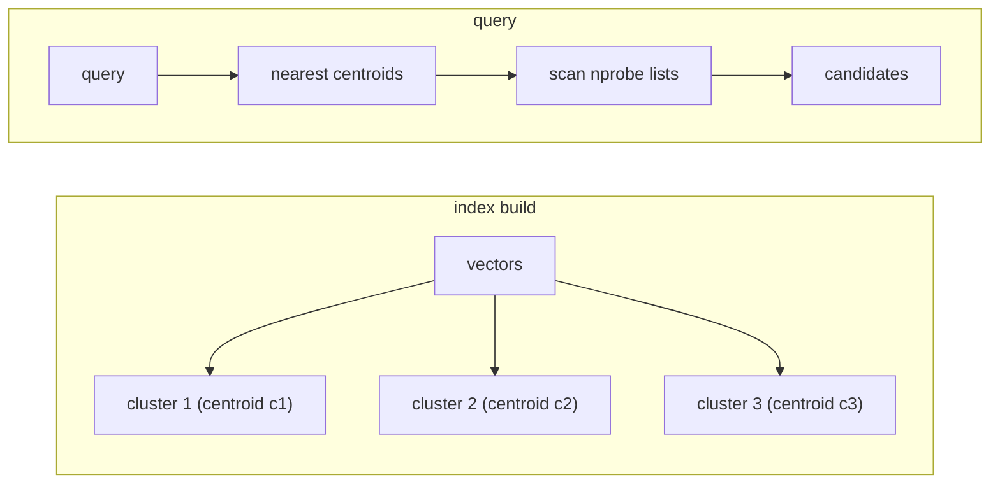
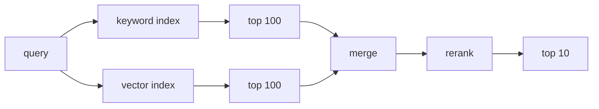
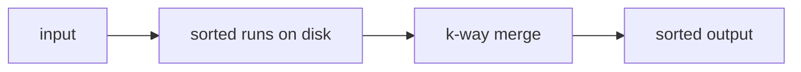

# Vector, Time-Series, and Big Data Structures

A general-purpose database is a good default. Some questions have a different shape: find similar items, scan billions of time-ordered points, or estimate a count without storing every item. This lesson covers when to specialize.

## Vector databases and embeddings

An embedding is a fixed-length list of numbers that represents meaning. A model turns text, images, or audio into vectors. Similar meaning tends to produce nearby vectors.



A vector database stores vectors and metadata and answers "which vectors are closest?" It fits semantic search, recommendations, deduplication, and retrieval for a language model.

A 768-dimension vector stored as 32-bit floats is about 3 KB. Fifty million documents is about 150 GB before index overhead, a different problem from a B-tree lookup by primary key.

## Approximate nearest neighbor

Exact nearest-neighbor search compares the query with every vector. At 50 million vectors, that is tens of billions of operations per query. Too slow. Approximate nearest neighbor (ANN) indexes trade a little recall for speed.

### HNSW

Hierarchical Navigable Small World (HNSW) builds a layered graph. Upper layers are sparse highways; lower layers hold every vector. Search starts at the top, moves greedily toward the query, then drops a layer.



HNSW gives high recall and low latency, but the graph lives in memory and updates cost more than appends.

### IVF

Inverted File (IVF) clusters vectors around centroids. A query checks the nearest centroids and scans those lists.



IVF uses less memory than HNSW and gives a direct recall/latency knob: probe more lists for better recall. Uneven clusters hurt it.

Quantization converts float32 vectors to int8 or product codes, cutting memory by roughly 4x. Recall drops, so measure it on real queries.

## Hybrid keyword and vector search

Keyword search is better for exact names, codes, rare terms, and fresh documents. Vector search is better for paraphrase and synonyms. A hybrid pipeline runs both, merges the ranked lists, and reranks the top candidates.



Merging can use weighted scores or reciprocal rank fusion. A reranker can be a cross-encoder or a rule. Filters such as tenant, locale, or access level must apply during the search; post-filtering an ANN result can return too few rows.

## Freshness and re-embedding

An embedding is tied to its content and model version. When either changes, the vector is stale. Store a content hash, model version, and timestamp with each vector. Re-embed changed chunks on update. On a model upgrade, build a new index beside the old one, backfill it, compare quality, then switch an alias. Do not overwrite the only index in place.

Re-embedding a large corpus is expensive and can take hours. Plan it as a batch job with rate limits, checkpoints, and a rollback path. Serving mixed old and new embeddings briefly is usually fine, but say so.

## Time-series databases

A time-series database stores values keyed by a series and a timestamp.

```text
series key: weather.sensor=17,site=warehouse
  10:00:00  21.4
  10:00:10  21.5
  10:00:20  21.6
```

The workload is append-heavy and read by time range for aggregation or the latest value. Writes arrive from many devices, sometimes late.

The store batches writes, keeps points in time-ordered blocks, and compresses each column. Delta encoding shrinks timestamps; XOR schemes shrink floats. Compression lets it keep far more data than a row store.

Two costs dominate:

- **Tag cardinality.** A tag with millions of values creates millions of series, each with overhead. Keep those dimensions out of the series key, or the index becomes the bottleneck.
- **Retention.** Downsample older data into one-minute and one-hour rollups, then delete raw blocks.

Worked estimate:

```text
50,000 sensors x 1 point / 10 s
= 8,640 points per sensor per day
= 432,000,000 points per day

16 bytes per raw point ~ 6.9 GB per day
10x compression      ~ 690 MB per day
30 days raw          ~ 21 GB
```

Keep raw data for 30 days, one-minute rollups for a year, and one-hour rollups for five years. Old queries read rollups and never touch raw points.

## Sketches and external sort

Some questions do not need the full data set. They need an answer with a bounded error.

### Bloom filter

A Bloom filter answers "is this item possibly in the set?" with a bit array and several hash functions.

```text
add(x): set bits h1(x), h2(x), h3(x)
query(x): all bits set? -> maybe present
          any bit clear?  -> definitely absent
```

There are no false negatives; false positives are possible. About 10 bits per item gives roughly a 1% false-positive rate. Use it to skip disk reads for absent keys.

### HyperLogLog

HyperLogLog estimates distinct values with fixed memory. It hashes each value, watches the longest run of leading zeros, and combines observations.

A 12 KB sketch gives roughly 0.8% error. An exact set of 100 million IDs might need hundreds of megabytes. The sketch cannot list users, but it answers "how many unique visitors today?", and daily sketches merge into weekly totals.

### Count-min sketch

A count-min sketch estimates item frequency. It uses a grid of counters and several hash functions, then takes the minimum counter for a query. Estimates only go up, and error is bounded by total count divided by grid width. It fits heavy hitters: the search terms or IPs most frequent right now.

### External sort

External sort handles data larger than memory.



Read a chunk that fits in memory, sort it, write a run, then merge runs with small buffers. Deduplication compares adjacent sorted records. A 2 TB file with 16 GB of memory becomes a few hundred runs, merged in several passes.

## When a specialized system is justified

Use a specialized store when the access pattern does not fit a general database: similarity search, time-range scans at heavy append rates, approximate answers with bounded error, or data volumes where row storage costs too much.

Do not add one when an index answers the query, the data set is small enough to scan, the team cannot operate another stateful system, or a second copy makes freshness too risky. Every specialized system needs security, backups, monitoring, and sync.

## Worked examples

**Semantic search.** Fifty million documents, 768-dimension vectors, about 150 GB raw. HNSW overhead may push the index to several hundred GB of memory. Shard by tenant or language, add replicas, quantize to int8, and keep a keyword index for exact matches. A model change needs a staged re-embedding job. Measure recall@10, not only latency.

**Metrics.** The sensor example fits a time-series database: batched writes, compressed blocks, rollups, and retention. A row store carries per-row overhead for every point and struggles with the write rate.

**Unique-count analytics.** One hundred million events per day. Keep one HyperLogLog per day and segment, then merge sketches for weekly totals. Use exact counts only for billing or audit.

**Large deduplication.** Two terabytes of records with duplicates. Hash each record, use a Bloom filter to reject most unseen keys, external sort the candidates, and compare full hashes for the rest. The filter saves memory; the sort gives an exact answer.

## Failure modes to name

- Recall drops after a filter, a model change, or a shift in data. Measure it on real queries.
- A vector index and its source drift without a sync or replay plan.
- High-cardinality tags create millions of series and overwhelm the index.
- Retention deletes raw data that an audit or model retrain still needs.
- A sketch is used for exact billing. Sketches have error bounds.
- A specialized store becomes an unbacked source of truth.

## What to say in an interview

> "Semantic search over 50 million documents needs 768-dimension embeddings in an ANN index. HNSW gives the latency target, but the graph is memory heavy, so I would shard, replicate, and quantize. Keyword search stays in the pipeline for exact names, and a reranker combines both lists. Re-embedding runs as a staged job into a new index, then an alias switch. The metrics write rate and time-range queries fit a time-series store with compression and rollups. I would use HyperLogLog only for the unique-visitor dashboard, not for billing."
