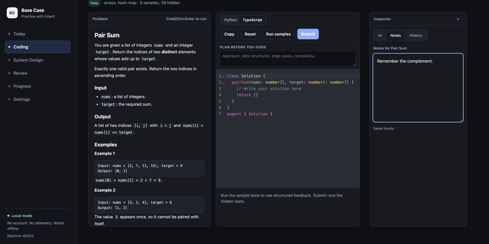
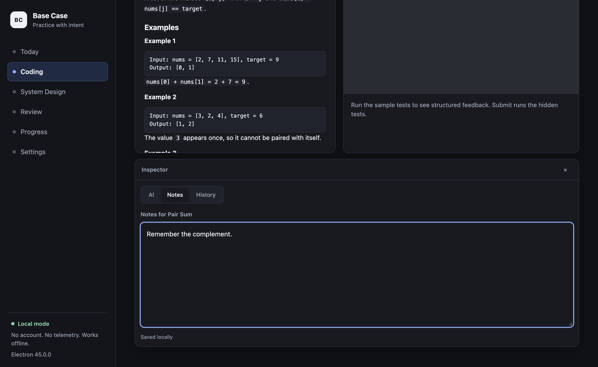
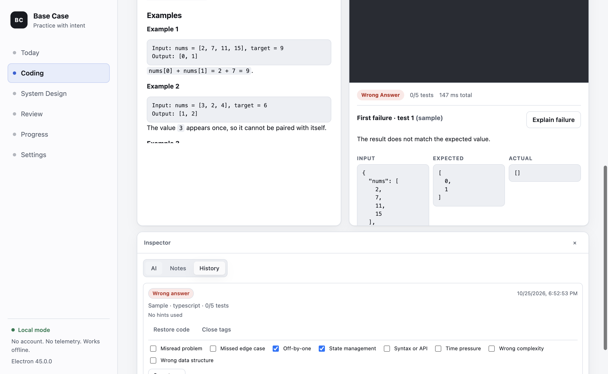
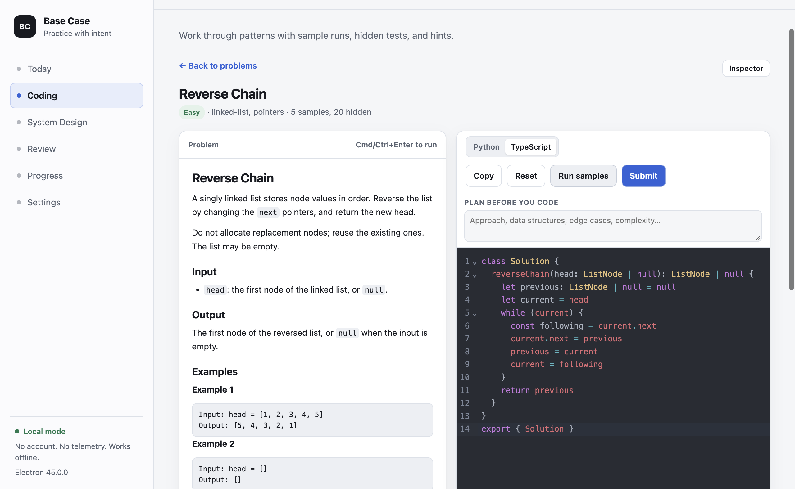
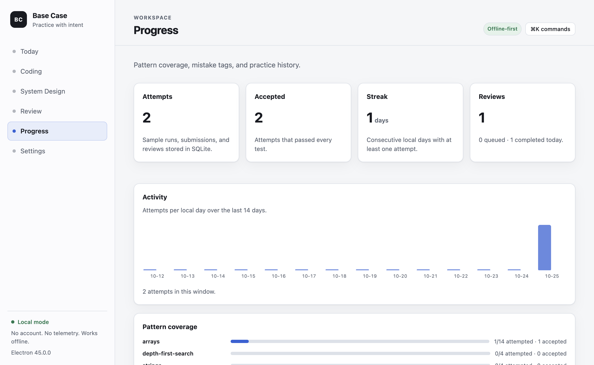
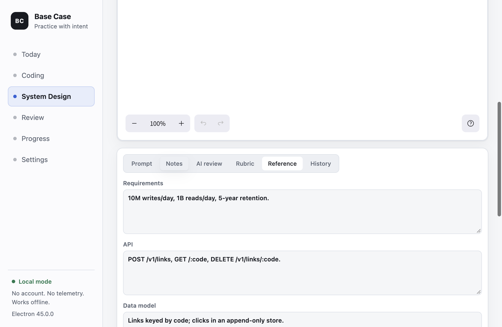
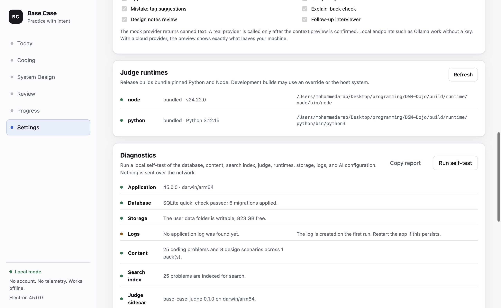

# Screenshots

Captured automatically from the Playwright suite with
`BASE_CASE_PLAYWRIGHT_SCREENSHOTS=docs/assets/screenshots pnpm smoke:playwright`.
The screenshots use a fresh local profile and the mock AI provider; no real
account, network service, or personal data is involved.

## Coding workspace

The inspector can sit beside the statement and editor on wide windows, or stack
below them on narrower ones.

## AI assistance

The AI panel previews the exact context before sending anything. The
explain-back check and user-confirmed mistake tags are shown after a failed
run.

## Expanded content

A linked-list problem from the 25-problem core pack, solved in TypeScript.

## Progress and review

The 14-day activity chart, pattern coverage, mistake tags, and review queue are
local SQLite views.

## System design

The design workspace keeps the canvas, structured notes, rubric, and reference
together.

## Diagnostics

The local self-test checks the database, storage, logs, content counts, search
index, judge, runtimes, and AI configuration without contacting the network.

